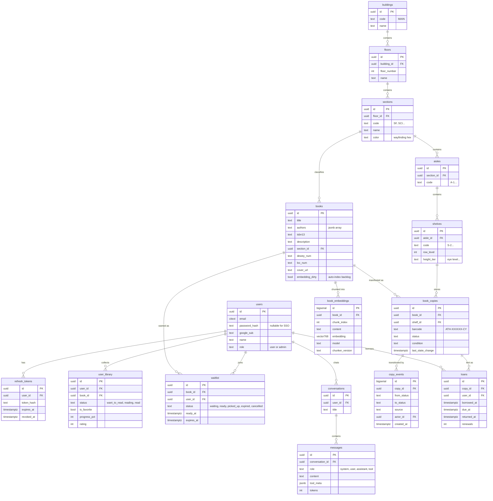

# Data Model

> Complete PostgreSQL 16 + pgvector schema for Athenaeum: ER diagram, `CREATE TABLE` DDL for all 15 tables + 1 view, indexes, query examples, and pgvector usage — the single source of truth for the database, consumed by [API](./03-api-spec.md), [seed](./08-seed-data.md), and [frontend](./07-frontend.md).

## Contents

1. [Overview](#1-overview)
2. [Extensions](#2-extensions)
3. [ER Diagram](#3-er-diagram)
4. [Table DDL (canonical SQL)](#4-table-ddl-canonical-sql)
5. [Indexes](#5-indexes)
6. [Views](#6-views)
7. [Query Examples](#7-query-examples)
8. [pgvector Notes](#8-pgvector-notes)
9. [Migration Conventions](#9-migration-conventions)

## 1. Overview

| Table | Purpose | Written by | Read by |
| --- | --- | --- | --- |
| `users` | Accounts (email/password + Google SSO), roles | [auth](./04-auth.md), admin users API | all authenticated APIs |
| `refresh_tokens` | Rotating sessions | auth refresh/logout | auth middleware |
| `books` | Bibliographic records | seed, admin, `fetch-isbn` | search, detail, chat RAG |
| `book_copies` | Physical copies w/ status + shelf | seed, admin, staff intake, patron self-return | detail, admin, wayfinding |
| `buildings` `floors` `sections` `aisles` `shelves` | Physical hierarchy | seed, admin layout | detail, admin tree |
| `user_library` | Personal reading list | personal library API | `/library` page |
| `waitlist` | Holds queue per book | waitlist API | detail, `/library` holds |
| `book_embeddings` | 768-dim description chunks | `cmd/reindex` | semantic + hybrid search, chat RAG |
| `conversations` `messages` | AI chat sessions | chat service | `/chat` page ([06](./06-ai-rag.md#7-conversation-persistence)) |
| `copy_events` | Admin audit-stream rows | copy + return mutations | admin audit stream |
| `loans` | Active + past borrowings (borrower, due date) | self-service checkout/return, admin | `/library` loans, detail |
| `book_locations` | **VIEW** — denormalized copy→building path | — | detail, wayfinding, export |
| `book_ratings` | **VIEW** — per-book average + count of `user_library.rating` | — | search, detail, `/catalog` |

Entities erased by codegen (IDs, FKs) are per-table below. Nested Hierarchy:
`Building → Floor → Section → Aisle → Shelf → book_copies` — semantics in
[05-building-layout.md](./05-building-layout.md), concrete mock values in
[13-mock-data-reference.md](./13-mock-data-reference.md).

## 2. Extensions

Migration `0001_extensions.sql`:

```sql
CREATE EXTENSION IF NOT EXISTS vector;      -- pgvector (pg16 image ships it)
CREATE EXTENSION IF NOT EXISTS pg_trgm;     -- title similarity fallback
CREATE EXTENSION IF NOT EXISTS citext;      -- case-insensitive unique emails
```

## 3. ER Diagram

`vector768` = `vector(768)` (Mermaid-safe alias; real DDL in §4).



## 4. Table DDL (canonical SQL)

Every code-generating agent must use these definitions verbatim in
`api/migrations/`. Status/enum vocabularies are **CHECK** constraints — the
state machine interpretation is in [12-ui-design.md](./12-ui-design.md#10-copy-state-machine).

### users

```sql
CREATE TABLE users (
  id            UUID PRIMARY KEY,
  email         CITEXT NOT NULL,
  password_hash TEXT,                     -- NULL for SSO-only accounts (argon2id, docs/04)
  google_sub    TEXT,                     -- unique when present
  name          TEXT NOT NULL DEFAULT '',
  role          TEXT NOT NULL DEFAULT 'user' CHECK (role IN ('user','admin')),
  created_at    TIMESTAMPTZ NOT NULL DEFAULT now(),
  updated_at    TIMESTAMPTZ NOT NULL DEFAULT now(),
  CONSTRAINT users_google_sub_unique UNIQUE (google_sub)
);
CREATE UNIQUE INDEX users_email_lower_key ON users ((lower(email)::text));
```

### refresh_tokens

```sql
CREATE TABLE refresh_tokens (
  id         UUID PRIMARY KEY,
  user_id    UUID NOT NULL REFERENCES users(id) ON DELETE CASCADE,
  token_hash TEXT NOT NULL,               -- sha256 of opaque refresh token
  expires_at TIMESTAMPTZ NOT NULL,        -- now + REFRESH_TTL (7d)
  revoked_at TIMESTAMPTZ,
  created_at TIMESTAMPTZ NOT NULL DEFAULT now()
);
CREATE UNIQUE INDEX refresh_tokens_hash_key ON refresh_tokens (token_hash);
CREATE INDEX refresh_tokens_user_idx ON refresh_tokens (user_id);
```

### books

```sql
CREATE TABLE books (
  id              UUID PRIMARY KEY,
  title           TEXT NOT NULL,
  subtitle        TEXT,
  authors         JSONB NOT NULL DEFAULT '[]',       -- ["Frank Herbert","..."]
  isbn13          TEXT,                               -- checksum-validated upstream, see docs/11
  isbn10          TEXT,
  publisher       TEXT,
  published_year  INT,
  description     TEXT,                               -- RAG chunk source, docs/06
  cover_url       TEXT,
  open_library_key TEXT,                              -- enrich provenance, docs/08
  dewey_num       TEXT,
  loc_num         TEXT,
  section_id      UUID REFERENCES sections(id),       -- default wayfinding section
  embedding_dirty BOOL NOT NULL DEFAULT false,        -- auto-index worker backlog (docs/06 §2)
  created_at      TIMESTAMPTZ NOT NULL DEFAULT now(),
  updated_at      TIMESTAMPTZ NOT NULL DEFAULT now()
);
CREATE UNIQUE INDEX books_isbn13_key ON books (isbn13) WHERE isbn13 IS NOT NULL;
CREATE INDEX books_embedding_dirty_idx ON books (embedding_dirty) WHERE embedding_dirty;
```

### book_copies

```sql
CREATE TABLE book_copies (
  id               UUID PRIMARY KEY,
  book_id          UUID NOT NULL REFERENCES books(id) ON DELETE CASCADE,
  barcode          TEXT NOT NULL CHECK (barcode ~ '^ATH-[0-9]{6}-C[0-9]{2}$'),  -- ATH-002941-C01 (copy numbers are 2-digit)
  status           TEXT NOT NULL DEFAULT 'available'
                   CHECK (status IN ('available','checked_out','reserved_waitlist','missing_lost')),
  condition        TEXT NOT NULL DEFAULT 'good',
  shelf_id         UUID REFERENCES shelves(id),       -- NULL = in-catalog only
  last_state_change TIMESTAMPTZ NOT NULL DEFAULT now(),
  created_at       TIMESTAMPTZ NOT NULL DEFAULT now(),
  updated_at       TIMESTAMPTZ NOT NULL DEFAULT now(),
  UNIQUE (barcode)
);
CREATE INDEX book_copies_book_idx ON book_copies (book_id);
CREATE INDEX book_copies_shelf_idx ON book_copies (shelf_id) WHERE shelf_id IS NOT NULL;
```

### buildings / floors / sections / aisles / shelves

```sql
CREATE TABLE buildings (
  id UUID PRIMARY KEY,
  code TEXT NOT NULL,                    -- 'MAIN'
  name TEXT NOT NULL,                    -- 'Main Building'
  address TEXT,
  created_at TIMESTAMPTZ NOT NULL DEFAULT now()
);

CREATE TABLE floors (
  id UUID PRIMARY KEY,
  building_id UUID NOT NULL REFERENCES buildings(id) ON DELETE CASCADE,
  floor_number INT NOT NULL,             -- starting 0 at lobby, 1..3 are stacks
  name TEXT NOT NULL,                    -- 'North Stacks'
  UNIQUE (building_id, floor_number)
);

CREATE TABLE sections (
  id UUID PRIMARY KEY,
  floor_id UUID NOT NULL REFERENCES floors(id) ON DELETE CASCADE,
  code TEXT NOT NULL,                    -- 'SF'
  name TEXT NOT NULL,                    -- 'Science Fiction & Speculative'
  color TEXT NOT NULL,                   -- canonical hex, docs/05 table
  UNIQUE (floor_id, code)
);

CREATE TABLE aisles (
  id UUID PRIMARY KEY,
  section_id UUID NOT NULL REFERENCES sections(id) ON DELETE CASCADE,
  code TEXT NOT NULL,                    -- 'A-1'
  UNIQUE (section_id, code)
);

CREATE TABLE shelves (
  id UUID PRIMARY KEY,
  aisle_id UUID NOT NULL REFERENCES aisles(id) ON DELETE CASCADE,
  code TEXT NOT NULL,                    -- 'S-2'
  row_level INT NOT NULL,                -- 4
  height_tier TEXT NOT NULL,             -- 'Eye Level'
  UNIQUE (aisle_id, code)
);
CREATE INDEX shelves_section_idx ON shelves (aisle_id);
```

### user_library

```sql
CREATE TABLE user_library (
  id           UUID PRIMARY KEY,
  user_id      UUID NOT NULL REFERENCES users(id) ON DELETE CASCADE,
  book_id      UUID NOT NULL REFERENCES books(id) ON DELETE CASCADE,
  status       TEXT NOT NULL DEFAULT 'want_to_read'
               CHECK (status IN ('want_to_read','reading','read')),
  is_favorite  BOOL NOT NULL DEFAULT false,
  progress_pct SMALLINT CHECK (progress_pct BETWEEN 0 AND 100),
  rating       SMALLINT CHECK (rating BETWEEN 1 AND 5),
  notes        TEXT,
  added_at     TIMESTAMPTZ NOT NULL DEFAULT now(),
  updated_at   TIMESTAMPTZ NOT NULL DEFAULT now(),
  UNIQUE (user_id, book_id)
);
CREATE INDEX user_library_user_idx ON user_library (user_id, updated_at DESC);
```

### waitlist

```sql
CREATE TABLE waitlist (
  id         UUID PRIMARY KEY,
  book_id    UUID NOT NULL REFERENCES books(id) ON DELETE CASCADE,
  user_id    UUID NOT NULL REFERENCES users(id) ON DELETE CASCADE,
  status     TEXT NOT NULL DEFAULT 'waiting'
             CHECK (status IN ('waiting','ready','picked_up','expired','cancelled')),
  ready_at   TIMESTAMPTZ,
  expires_at TIMESTAMPTZ,                -- ready_at + 48h (docs/12 state machine)
  created_at TIMESTAMPTZ NOT NULL DEFAULT now(),
  updated_at TIMESTAMPTZ NOT NULL DEFAULT now()
);
CREATE INDEX waitlist_book_active_idx ON waitlist (book_id, created_at)
  WHERE status IN ('waiting','ready');
```

### book_embeddings

```sql
CREATE TABLE book_embeddings (
  id              BIGSERIAL PRIMARY KEY,
  book_id         UUID NOT NULL REFERENCES books(id) ON DELETE CASCADE,
  chunk_index     INT NOT NULL,
  content         TEXT NOT NULL,           -- chunked description (~300 tokens, docs/06)
  embedding       vector(768) NOT NULL,
  model           TEXT NOT NULL,           -- 'nomic-embed-text'
  chunker_version TEXT NOT NULL,           -- 'v1' - see docs/06 chunking
  created_at      TIMESTAMPTZ NOT NULL DEFAULT now(),
  UNIQUE (book_id, chunk_index)
);
CREATE INDEX book_embeddings_hnsw
  ON book_embeddings USING hnsw (embedding vector_cosine_ops)
  WITH (m = 16, ef_construction = 64);
```

> ⚠️ Note: the literal column type is `embedding vector(768) NOT NULL` — the
> 768 dims match `OLLAMA_EMBED_DIM`; if the model changes, rows must be reindexed
> via `cmd/reindex` ([08-seed-data.md](./08-seed-data.md#7-reindex)).

### conversations / messages

```sql
CREATE TABLE conversations (
  id         UUID PRIMARY KEY,
  user_id    UUID NOT NULL REFERENCES users(id) ON DELETE CASCADE,
  title      TEXT NOT NULL DEFAULT 'New conversation',   -- set from first message, docs/06
  created_at TIMESTAMPTZ NOT NULL DEFAULT now(),
  updated_at TIMESTAMPTZ NOT NULL DEFAULT now()
);
CREATE INDEX conversations_user_idx ON conversations (user_id, updated_at DESC);

CREATE TABLE messages (
  id              UUID PRIMARY KEY,
  conversation_id UUID NOT NULL REFERENCES conversations(id) ON DELETE CASCADE,
  role            TEXT NOT NULL CHECK (role IN ('system','user','assistant','tool')),
  content         TEXT,
  tool_meta       JSONB,                  -- {tool_call_id, name, args, result} for tool messages; {citations:[…]} for assistant messages
  tokens          INT,
  created_at      TIMESTAMPTZ NOT NULL DEFAULT now()
);
CREATE INDEX messages_conversation_idx ON messages (conversation_id, created_at);
```

### copy_events

```sql
CREATE TABLE copy_events (
  id          BIGSERIAL PRIMARY KEY,
  copy_id     UUID NOT NULL REFERENCES book_copies(id) ON DELETE CASCADE,
  from_status TEXT,                       -- NULL on initial insert
  to_status   TEXT NOT NULL,
  source      TEXT NOT NULL,              -- 'admin_patch' | 'scanner' | 'waitlist' | 'seed' | 'self_return'
  actor_id    UUID REFERENCES users(id),
  created_at  TIMESTAMPTZ NOT NULL DEFAULT now()
);
CREATE INDEX copy_events_recent_idx ON copy_events (created_at DESC);
```

### loans

A borrowing: an open loan has `returned_at IS NULL` (at most one open loan per copy —
enforced by the partial unique index). **No fines** and no borrower-facing notices in
v1 ([10 §2](10-roadmap.md#2-out-of-scope--deferred)); the loan is the borrower link the
[01 §8](01-architecture.md#8-cross-cutting-rules) rule previously omitted.

```sql
CREATE TABLE loans (
  id          UUID PRIMARY KEY,
  copy_id     UUID NOT NULL REFERENCES book_copies(id) ON DELETE CASCADE,
  user_id     UUID NOT NULL REFERENCES users(id) ON DELETE CASCADE,
  borrowed_at TIMESTAMPTZ NOT NULL DEFAULT now(),
  due_at      TIMESTAMPTZ NOT NULL,                   -- borrowed_at + LOAN_PERIOD (14d)
  returned_at TIMESTAMPTZ,                            -- NULL while the loan is open
  renewals    SMALLINT NOT NULL DEFAULT 0 CHECK (renewals >= 0),
  created_at  TIMESTAMPTZ NOT NULL DEFAULT now(),
  updated_at  TIMESTAMPTZ NOT NULL DEFAULT now()
);
CREATE UNIQUE INDEX loans_open_copy_key ON loans (copy_id) WHERE returned_at IS NULL;
CREATE INDEX loans_user_open_idx ON loans (user_id, due_at) WHERE returned_at IS NULL;
CREATE INDEX loans_copy_idx ON loans (copy_id, borrowed_at DESC);
```

- Created by `POST /api/copies/{id}/borrow` (self-service checkout) with
  `due_at = now() + 14d`; closed by `POST /api/copies/{id}/return` (`returned_at = now()`).
  `POST /api/copies/{id}/renew` adds 14d and increments `renewals` (max 1 renewal).
  Full contract: [03 §6.5-6.7](03-api-spec.md#65-post-apicopiesidborrow).
- `book_copies.status` remains the fast availability flag; `loans` is the
  who/when/until record. Both change in one transaction, and every transition appends a
  `copy_events` row (`source` = `self_checkout` / `self_return`).

## 5. Indexes

Beyond all inline indexes above, the full-text + vector layer:

```sql
CREATE INDEX books_fts_idx ON books
  USING gin (to_tsvector('english', title || ' ' || title || ' ' || coalesce(description, '')));
CREATE INDEX books_title_trgm_idx ON books USING gin (title gin_trgm_ops);
CREATE INDEX books_section_idx ON books (section_id);
CREATE INDEX users_role_idx ON users (role);
```

| Name | Type | Serves |
| --- | --- | --- |
| `books_fts_idx` | GIN tsvector | keyword search ([03](./03-api-spec.md#51-get-apibookssearch)) |
| `books_title_trgm_idx` | GIN trigram | partial-substring search |
| `books_isbn13_key` | Partial unique | dedupe + `fetch-isbn` conflict check |
| `book_embeddings_hnsw` | HNSW cosine | semantic + hybrid + RAG top-K (below) |
| `book_copies_book_idx` | BTree | detail copy manifest |
| `loans_open_copy_key` | Partial unique | one open loan per copy |
| `loans_user_open_idx` | Partial BTree | my loans + borrow-limit check |
| `waitlist_book_active_idx` | Partial BTree | queue position calc |

## 6. Views

### 6.1 `book_locations`

Denormalized physical path powering copy manifest + turn-by-turn wayfinding
([05-building-layout.md](./05-building-layout.md#4-wayfinding-resolution)):

```sql
CREATE OR REPLACE VIEW book_locations AS
SELECT
  bc.id                  AS copy_id,
  bc.barcode,
  bc.status              AS copy_status,
  b.id                   AS book_id,
  b.title,
  bd.code                AS building_code,
  bd.name                AS building_name,
  fl.floor_number,
  fl.name                AS floor_name,
  se.code                AS section_code,
  se.name                AS section_name,
  se.color               AS section_color,
  ai.code                AS aisle_code,
  sh.id                  AS shelf_id,
  sh.code                AS shelf_code,
  sh.row_level,
  sh.height_tier,
  bd.code || '/' || fl.floor_number::text || 'F/' || se.code || '/' ||
  ai.code || '/' || sh.code                AS path,          -- MAIN/3F/SF/A-1/S-2
  NULLIF(bd.name, '') || ' (' || fl.name || ')' || ' → ' || se.name
  || ' → ' || ai.code || ' → ' || sh.code || ' (' || sh.height_tier || ')'
                                             AS display_ladder
FROM book_copies bc
JOIN books b      ON b.id = bc.book_id
LEFT JOIN shelves sh   ON sh.id = bc.shelf_id
LEFT JOIN aisles ai    ON ai.id = sh.aisle_id
LEFT JOIN sections se  ON se.id = ai.section_id
LEFT JOIN floors fl    ON fl.id = se.floor_id
LEFT JOIN buildings bd ON bd.id = fl.building_id;
```

- Rows with `copy_status='checked_out'` still expose the home path (ladder only
  fetched for queryable copies; detail UI decides display).
- Copies without `shelf_id` (`NULL`) result in `NULL` path/ladder columns — the
  ladder is omitted downstream (in-catalog only).

### 6.2 `book_ratings`

Average + count of patron ratings, derived from `user_library.rating` (computed on read,
never denormalized — decided 2026-10-16). Books with no ratings are absent from the view;
callers render "no ratings yet".

```sql
CREATE OR REPLACE VIEW book_ratings AS
SELECT
  book_id,
  round(avg(rating)::numeric, 1) AS rating_avg,   -- 1 decimal
  count(*)                       AS rating_count
FROM user_library
WHERE rating IS NOT NULL
GROUP BY book_id;
```

Read by `GET /api/books/search`, `GET /api/books/{id}` and the catalog cards
([03 §5.1](03-api-spec.md#51-get-apibookssearch)).

## 7. Query Examples

Keyword (BM25-like ranking), for `GET /api/books/search?q=dune&mode=keyword`:

```sql
SELECT id, title, ts_rank(
    to_tsvector('english', title || ' ' || coalesce(description, '')),
    websearch_to_tsquery('english', 'dune')
) AS score,
       count(*) FILTER (WHERE bc.status = 'available') AS available_copies,
       count(*) AS total_copies
FROM books
JOIN book_copies bc ON bc.book_id = books.id
GROUP BY books.id
ORDER BY score DESC;
```

Semantic top-K, for `mode=semantic` and RAG retrieval:

```sql
SELECT book_id, chunk_index, 1 - (embedding <=> $1) AS cosine
FROM book_embeddings
ORDER BY embedding <=> $1
LIMIT 8;
```

Hybrid (Reciprocal Rank Fusion, k=60; both halves respect identical facets):

```sql
WITH kw AS (SELECT id, ts_rank(...) AS r FROM books WHERE ...)
     vec AS (SELECT book_id, 1 - (embedding <=> $1) AS r FROM book_embeddings ... ORDER BY 2 DESC LIMIT 20),
     kw_ranked AS (SELECT id, ROW_NUMBER() OVER (ORDER BY r DESC) AS rnk FROM kw),
     vec_ranked AS (SELECT book_id, ROW_NUMBER() OVER (ORDER BY r DESC) AS rnk FROM vec)
SELECT b.*,
       COALESCE(1.0 / (60 + kw_ranked.rnk), 0.0)
     + COALESCE(1.0 / (60 + vec_ranked.rnk), 0.0) AS score
FROM vec_ranked
LEFT JOIN kw_ranked ON kw_ranked.id = vec_ranked.book_id
JOIN books b ON b.id = vec_ranked.book_id
ORDER BY score DESC LIMIT 20;
```

`<=>` is cosine distance; similarity = `1 - distance`.

Implementation note: fusion runs in the service layer (`catalog.FuseRRF`) over the keyword
top-20 and the vector top-20 (best chunk per book), and returns the **union** of both
lists, so keyword-only hits (e.g. an author match) still surface; a book ranked 1st in both
lists scores `2/61`. Keyword relevance = `ts_rank` + title-trigram similarity + substring
bonuses for title/author matches.
