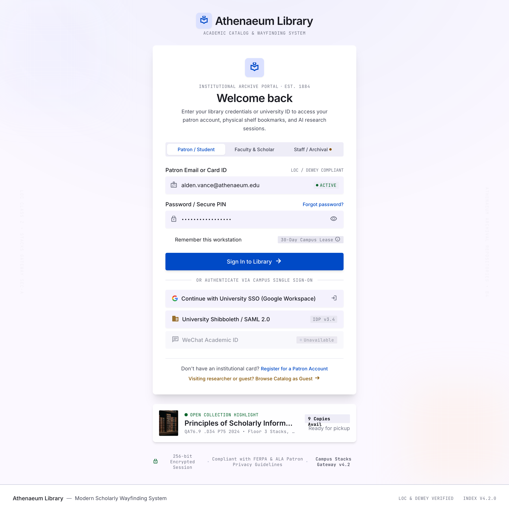
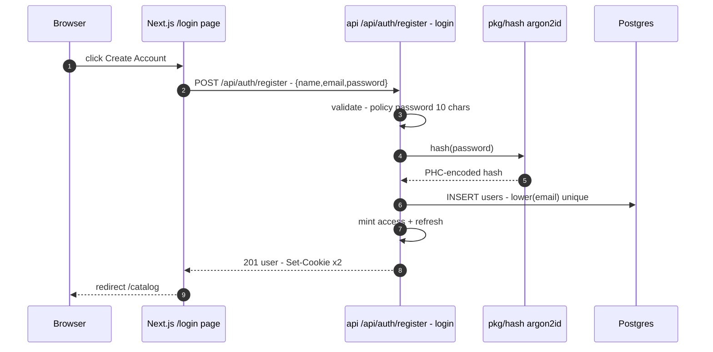
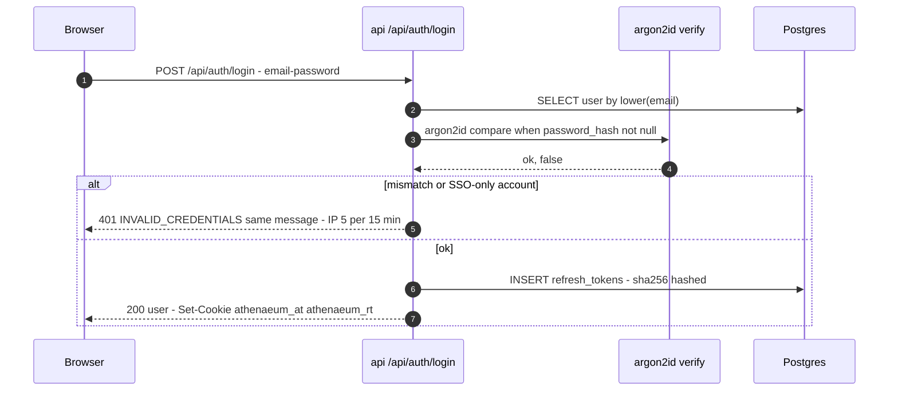
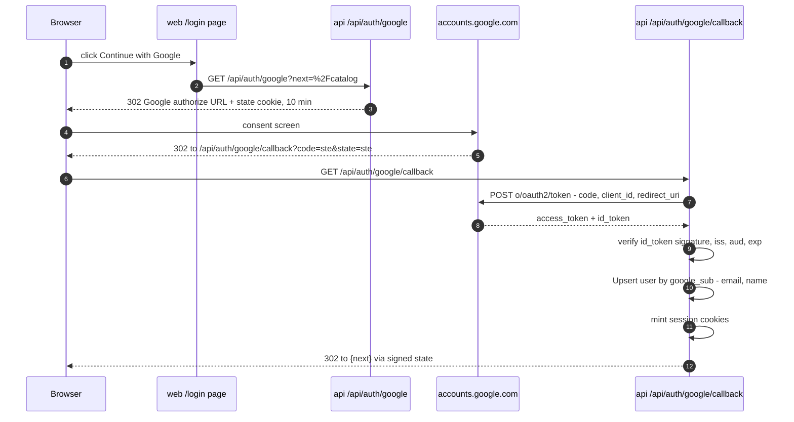

# Authentication & Sessions

> Athenaeum auth: email/password registration + login, Google SSO, WeChat placeholder, argon2id hashing, JWT access + rotating refresh tokens in httpOnly cookies, middleware wiring — HTTP surfaces in [03-api-spec.md](./03-api-spec.md#4-auth-endpoints), tables in [02-data-model.md](./02-data-model.md).

## Contents

1. [Login Screen (Stitch)](#1-login-screen-stitch)
2. [Email/password Flow](#2-emailpassword-flow)
3. [Google SSO](#3-google-sso)
4. [WeChat Placeholder](#4-wechat-placeholder)
5. [Token Model](#5-token-model)
6. [Password Hashing](#6-password-hashing)
7. [Roles & Route Protection](#7-roles--route-protection)
8. [Identity Edge Cases](#8-identity-edge-cases)

## 1. Login Screen (Stitch)

Stitch screen **Sign In - Athenaeum Library** (ID `b6e00ec93bff4f7dbabfeefcaad1166e`,
2560×2536 @2x): focused gateway canvas — no app shell nav — with institutional
masthead, role switcher tabs, email/password, Google SSO button, disabled WeChat
button, and open-collection spotlight preview. Design details in
[12-ui-design.md](./12-ui-design.md#screen-1--login-institution-gateway) · exported screenshot manifest row
in `.artifacts/stitch/stitch-manifest.json`.



Exported artifacts: `.artifacts/stitch/sign_in_athenaeum_library/{screen.png, code.html}`
(manifest row: `b6e00ec93bff4f7dbabfeefcaad1166e`). Verified against the export:
role-switcher tabs **Patron / Student · Faculty & Scholar · Staff** ✓, **WeChat
Academic ID button disabled** ✓ (`disabled` on the button; labeled "Unavailable"),
`EST. 1884` badge ✓, Open Collection spotlight ✓. DESIGN.md's Shibboleth/SAML
row survives only as an HTML comment in the export — render nothing for it:
[10-roadmap.md](./10-roadmap.md).

## 2. Email/password Flow

Registration and login share shape; both issue a fresh session.





## 3. Google SSO

Canonical flow is the redirect (auth code) flow; the login page button is a plain
`<a href="/api/auth/google">`. Code exchange happens server-side with
`GOOGLE_OAUTH_CLIENT_ID/SECRET` ([01](./01-architecture.md#5-external-integrations)).



- Upsert by `google_sub`; when a `lower(email)` match already exists with a
  password hash, link the account silently (no 409) — visible to admins only via
  the `"linked": true` audit log.
- New SSO accounts get `role='user'`; `users.password_hash` stays NULL.
- Bad code/expired state → 302 `{web}/login?error=sso`.
- Implementation notes: the state cookie (`athenaeum_oauth_state`, path `/api/auth/google`,
  10 min, single use) carries `nonce.next.exp.hmac` signed with `JWT_REFRESH_SECRET`; `next`
  must be a same-site relative path (else `/catalog`); the redirect URI is
  `{WEB_ORIGIN}/api/auth/google/callback`; the issuer is overridable via
  `GOOGLE_OAUTH_ISSUER` so tests can use a fake OIDC provider.

## 4. WeChat Placeholder

The login screen renders a WeChat SSO button in strict disabled state (styling and
copy per [DESIGN.md §Screen 1](./12-ui-design.md#screen-1--login-institution-gateway)) with tooltip
"Coming soon". No backend route exists; clicking does nothing.

> ⚠️ TODO: WeChat SSO — deferred (button disabled in [12-ui-design.md](./12-ui-design.md#screen-1--login-institution-gateway); out of scope [10-roadmap.md](./10-roadmap.md)).

## 5. Token Model

| Token | Cookie name | Format | TTL | Storage | Notes |
| --- | --- | --- | --- | --- | --- |
| Access JWT | `athenaeum_at` | HS256 signed compact JWT | 15 min (`ACCESS_TTL`) | stateless | `sub`, `role`, `email`, `iat`, `exp`, `iss="athenaeum"`, `aud="athenaeum-web"` |
| Refresh | `athenaeum_rt` | 256-bit random, base64url | 7 days (`REFRESH_TTL`) | sha256 hash in `refresh_tokens.token_hash` | one row per session; rotated on each refresh; replay → revoke family |

Cookie flags: `HttpOnly; Secure` (prod) / `Path=/: SameSite=Lax`; CSFR via
SameSite=Lax + state cookie for OAuth. `Path=/` scopes both.

```go
// internal/pkg/jwt
claims := jwt.MapClaims{
    "sub":   user.ID,
    "email": user.Email,
    "role":  user.Role,
    "iss":   "athenaeum",
    "aud":   "athenaeum-web",
    "iat":   now.Unix(),
    "exp":   now.Add(cfg.ACCESS_TTL).Unix(),
}
```

- Refresh **rotation**: `POST /api/auth/refresh` atomically marks the presented
  token `revoked_at` and issues a new one (`UPDATE ... WHERE revoked_at IS NULL`).
- **Replay detection**: a second rotation with the same hash closes the rows
  within 250 ms → 401 `REUSED_TOKEN`, destroys all rows of the session's family.
- Logout revokes every refresh row of the session and clears cookies.

## 6. Password Hashing

`golang.org/x/crypto/argon2` ID with PHC string format in storage.

| Param | Value |
| --- | --- |
| Variant | argon2id |
| Memory | 64 MiB (`m=65536,t=3,p=2`) |
| Salt | 16 B random (base64) |
| Output key | 32 B (base64) |
| Storage format | `$argon2id$v=19$m=65536,t=3,p=2$<salt_b64>$<hash_b64>` |

- Verify with strict PHC parse; timing-equal regardless of hit/miss.
- Login/racy equal-runtime integrity is preserved (constant failure timing).

## 7. Roles & Route Protection

Roles: `user` and `admin` only ([README](./README.md#1-project-overview)).

| Middleware | Applies to | Behavior |
| --- | --- | --- |
| `RequireAuth` | every `/api/*` except public routes below | validates `athenaeum_at`; on expiry → 401 `UNAUTHENTICATED` (browser client auto-calls refresh once). injects `user_id`, `role` into gin ctx |
| `RequireAdmin` | `/api/admin/*` | role must be `admin` → else 403 `FORBIDDEN` |
| Public routes | `/api/health`, `/api/auth/register`, `/api/auth/login`, `/api/auth/*` (all auth routes) | see [03 §3](./03-api-spec.md#3-endpoint-index) auth col |

Page guards live client-side on `web` ([07-frontend.md](./07-frontend.md#4-auth-context--guards))
— middleware re-checks everything server-side first.

## 8. Identity Edge Cases

| Case | Behavior |
| --- | --- |
| Password login by Google-linked user | same as normal login |
| First Google login for an email with existing password | auto-link + log `"linked": true`([§3](#3-google-sso)) |
| Rate limited `login`/`register` | 429 `RATE_LIMITED` w/ `Retry-After` ([03 §2](./03-api-spec.md#2-rate-limiting)) |
| Expired access + valid refresh | browser calls `/api/auth/refresh` (single retry) — never surfaces 401 to the patron |
| Password reset | no flow in v1 — account recovery admin-only (docs: [10-roadmap.md](./10-roadmap.md)) |

> ⚠️ TODO: password reset, Shibboleth/SAML v3.x, WeChat SSO — deferred, all in
> [10-roadmap.md](./10-roadmap.md).
