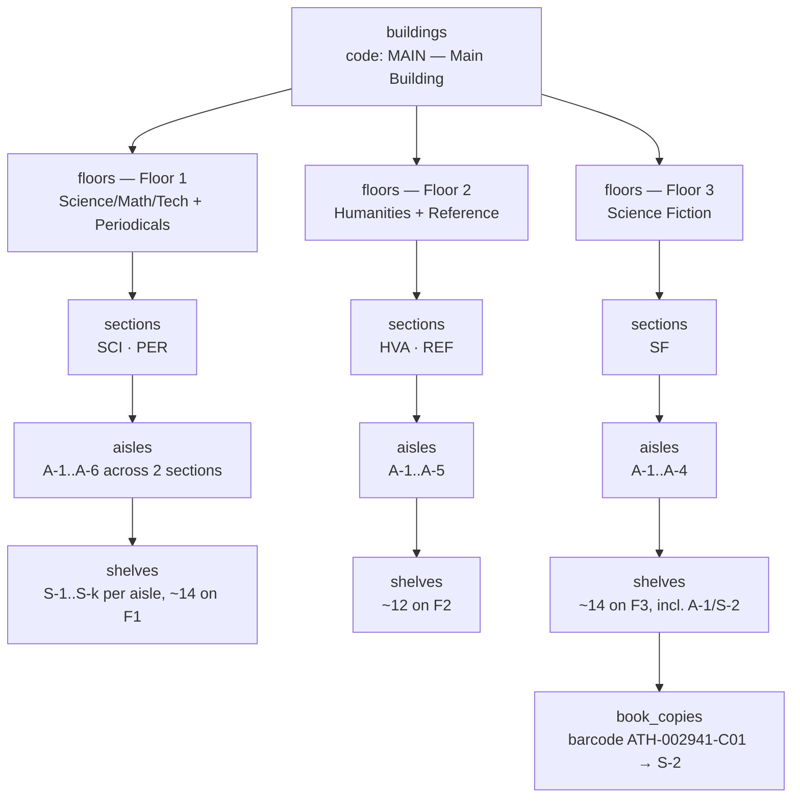

# Building Layout

> The physical library model: Building → Floor → Section → Aisle → Shelf → book_copies, section categories with wayfinding colors, location-path token format, wayfinding resolution, and seed harness pointer — hierarchy values in [13-mock-data-reference.md](./13-mock-data-reference.md), tables in [02-data-model.md](./02-data-model.md).

## Contents

1. [Hierarchy](#1-hierarchy)
2. [Section Categories](#2-section-categories)
3. [Location Path Tokens](#3-location-path-tokens)
4. [Wayfinding Resolution](#4-wayfinding-resolution)
5. [Book Detail Screen (Stitch)](#5-book-detail-screen-stitch)
6. [Mock Data & Seeding](#6-mock-data--seeding)

## 1. Hierarchy

One building in v1 (multi-building is out of scope — [10-roadmap.md](./10-roadmap.md)).
Every physical copy `book_copies.shelf_id` points at exactly one shelf; shelves
resolve upward to a unique textual path:



Concrete counts and all 40 shelves: [13-mock-data-reference.md](./13-mock-data-reference.md#4-shelf-inventory-all-40).

## 2. Section Categories

Canonical wayfinding colors (unchanged from DESIGN.md; also stored as
`sections.color` — [02](02-data-model.md#4-table-ddl-canonical-sql)):

| Code | Section name | Color hex | Floor(s) |
| --- | --- | --- | --- |
| `SCI` | Science, Mathematics & Tech | `#10B981` | 1 |
| `PER` | Periodicals & Archives | `#F59E0B` | 1 |
| `HVA` | History, Humanities & Arts | `#8B5CF6` | 2 |
| `REF` | Reference & Special Folios | `#6B7280` | 2 |
| `SF` | Science Fiction & Speculative | `#3B82F6` | 3 |

- Colors render as hairline left-edge tags, status badges, and filter dots — never as fills
  ([12-ui-design.md](./12-ui-design.md#2-wayfinding-section-colors)).
- UI copy references sections by name; API accepts and returns sections by `code`.

## 3. Location Path Tokens

Compact machine path plus a prose ladder; both derive from the joins in the
[`book_locations` view](./02-data-model.md#6-book_locations-view).

```
MAIN / 3F / SF / A-1 / S-2
building code / floor / section / aisle / shelf
```

- `3F` = `floors.floor_number`; a lobby-only floor would be `0F`.
- Display ladder for UI (example, Dune copy 1):
  `Main Building (North Stacks) → Floor 3 → Science Fiction & Speculative → Aisle A-1 → Shelf S-2 (Row 4, Eye Level)`.
- `display_ladder` wording template: `{building_name} ({floor_name}) → Floor {n} →
  {section_name} → Aisle {aisle_code} → Shelf {shelf_code} (Row {row_level}, {height_tier})`.

## 4. Wayfinding Resolution

Algorithms that map paths ⟷ `shelf_id` (used by seed, admin APIs, book detail).

```
resolve_path(path) -> shelf_id?
  parts = [MAIN, 3F, SF, A-1, S-2]
  building  = buildings WHERE code = parts[0]         -- 404 unless exactly 1 match
  floor     = floors WHERE building_id = building AND floor_number = d(parts[1] minus 'F')  -- 404
  section   = sections WHERE floor_id = floor AND code = parts[2]      -- 404
  aisle     = aisles  WHERE section_id = section AND code = parts[3]   -- 404
  shelf     = shelves WHERE aisle_id = aisle AND code = parts[4]       -- 404
  return shelf.id

build_path(shelf_id) -> path   -- inverse via one JOIN chain (view `book_locations.path`)
```

Callers: `cmd/seed` resolves every `shelf_path` in `mocks/books.json`
([08-seed-data.md](./08-seed-data.md#4-seed-algorithm)), the admin copies APIs accept
`shelf_path` directly ([03 §8.3](./03-api-spec.md#83-admin-copies)), and the book
detail + admin tree APIs return `location.path` to the clients.

## 5. Book Detail Screen (Stitch)

Stitch screen **Book Detail: Dune - Athenaeum Library** (ID `723960ca2605417eb085f6e17a579bd2`,
2560×4884 @2x): 40/60 two-column layout, tri-state availability banner,
turn-by-turn ladder, physical copy manifest (`ATH-002941-C01..C3`), archival
affinity carousel. Layout spec: [12-ui-design.md](./12-ui-design.md#screen-3--booksid-book-detail--spatial-wayfinding) ·
route/page: [07-frontend.md](./07-frontend.md#booksid--screen-3-stitch-723960ca).

Exported artifact: `.artifacts/stitch/book_detail_dune_athenaeum_library/code.html`
(export-verified: ladder = Floor 3 → North Stacks → Aisle A-1, "Row 4, Eye Level",
copy manifest `ATH-002941-C01/C2/C3` — matching seeded mock data,
[13-mock-data-reference.md](./13-mock-data-reference.md#3-copy-status-ledger)).

> ⚠️ TODO: `screen.png` for this screen failed during export
> (`<FIFE Image failed to fetch>` — runbook: [12 §7.1.1](./12-ui-design.md#711-stitch-mcp-tool-verification--export-runbook));
> re-export while logged in, save as `screen.png` in that folder, and re-add the embed.

## 6. Mock Data & Seeding

- `api/mocks/building.json` — 1 building, 3 floors, 5 sections, 15 aisles, 40 shelves
  (schema: [08-seed-data.md](./08-seed-data.md#2-mocksbuildingjson-schema); full value catalog incl.
  the shelf at `MAIN/3F/SF/A-1/S-2`: [13](./13-mock-data-reference.md#4-shelf-inventory-all-40)).
- `cmd/seed` builds the tree first, then books + copies; `cmd/reindex` builds embeddings.
- Admin layout page edits the same hierarchy at runtime ([07 §admin](./07-frontend.md#admin--screen-6a-stitch-3177da52)).
