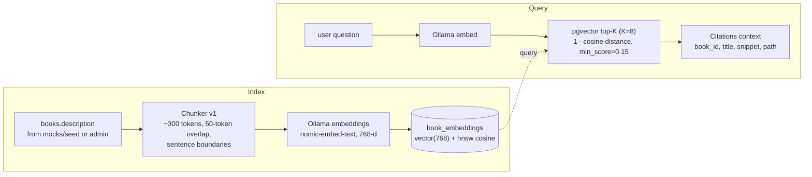
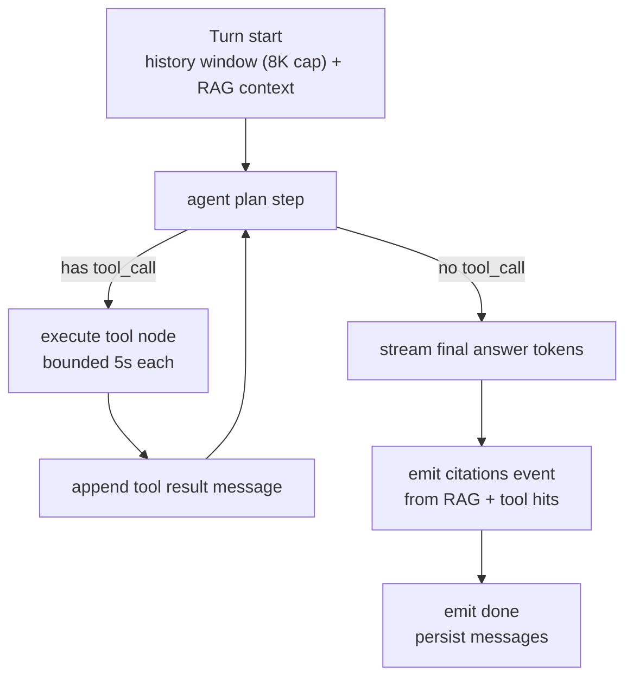
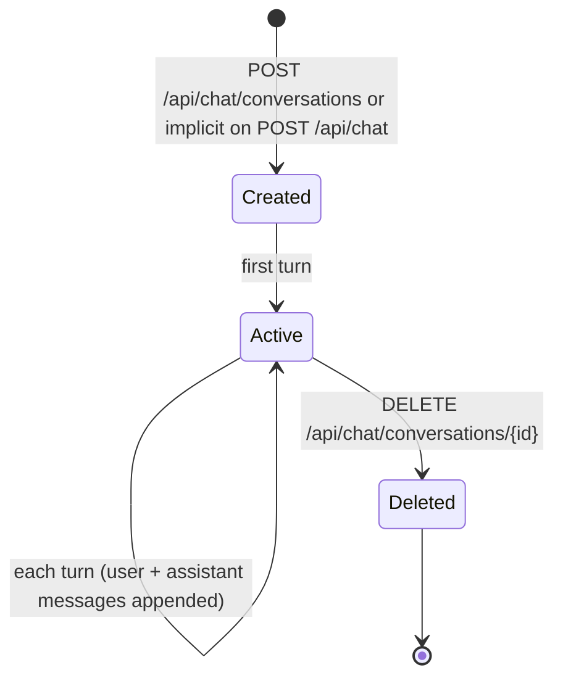

# AI Librarian & RAG

> The `/chat` feature: CloudWeGo Eino agent loop, four catalog tools, RAG retrieval over 768-dim Ollama embeddings, OpenRouter chat model behind an ACL adapter, SSE event contract, guardrails, and conversation persistence — endpoints in [03-api-spec.md](./03-api-spec.md#7-chat-sse), tables in [02-data-model.md](./02-data-model.md).

## Contents

1. [Architecture](#1-architecture)
2. [RAG Pipeline](#2-rag-pipeline)
3. [Eino Agent Loop](#3-eino-agent-loop)
4. [Tool Definitions](#4-tool-definitions)
5. [Provider Configuration (ACL)](#5-provider-configuration-acl)
6. [SSE Event Contract](#6-sse-event-contract)
7. [Conversation Persistence](#7-conversation-persistence)
8. [Guardrails](#8-guardrails)
9. [Chat Screen (Stitch)](#9-chat-screen-stitch)

## 1. Architecture

All code in `api/internal/service/ai/` (`agent.go`, `rag.go`, `tools.go`,
`stream.go`, `providers.go`). Eino components + custom adapters; no AI logic in
handlers ([01 layering](./01-architecture.md#2-backend-layers)).

```mermaid
flowchart LR
    Q["user message"] --> RT["Rate limit + persistence<br/>service/ai"]
    RT --> RET["RAG retrieve<br/>pgvector top-K"]
    RET --> AG["Eino React Agent<br/>plan + tools"]
    AG --> TL["tools<br/>search_catalog, get_book_location,<br/>check_availability, recommend_similar"]
    TL --> PG[("Postgres 16 + pgvector")]
    AG -- token stream --> SSE["SSE writer<br/>meta, token, tool_call, tool_result,<br/>citations, done, error"]
    Q -. "System prompt + 8K window" --> AG
    SSE -- "persist" --> CV[("conversations + messages")]
```

## 2. RAG Pipeline

Indexing side runs in `cmd/reindex` ([08 §reindex](08-seed-data.md#7-reindex)); query
side runs inside the agent turn.



| Parameter | Value |
| --- | --- |
| Chunk size | ~300 tokens (trim to whole sentence boundaries) |
| Overlap | ~50 tokens |
| Top-K | 8 chunks, distinct books preferred (max 4 chunks/book) |
| Distance metric | cosine (`vector_cosine_ops`), `min_score` 0.15 |
| Model | `OLLAMA_EMBED_MODEL` = `nomic-embed-text`, dim `768` |
| Versioning | `chunker_version` ('v1') + `model` columns; stale rows re-embedded by [reindex](08-seed-data.md#7-reindex) ([02](02-data-model.md#book_embeddings)) |

Implementation notes (chunker `v1`): each indexed passage is embedded as
`search_document: {title} by {authors}. {chunk}` and each query as `search_query: {query}`
(nomic-embed-text task prefixes); `book_embeddings.content` stores only the chunk. All
embeddings are computed before a single write transaction, so an Ollama outage never
leaves a partial index (exit code 3).

RAG context joins the system prompt as numbered findings; the agent must cite
`[doc#N]` markers, converted to citations by the API layer.

> ⚠️ TODO: the embedding model is English-only, so a `zh-CN` question retrieves poorly
> from pgvector; the agent compensates by forming English `search_catalog` queries.
> Multilingual embeddings or query translation is deferred ([14 §11](14-localization.md#11-known-limitations)).

## 3. Eino Agent Loop

Eino `react` agent with tool registry; models exchange via Eino `ChatModel`
interface ([05 ACL](#5-provider-configuration-acl)).



| Config | Value |
| --- | --- |
| Max tool iterations | 4 per turn |
| Per-tool timeout | 5 s; failure → tool observations with error text (agent retries or answers without) |
| Turn token window | ~8K tokens of message history (oldest-first-drop; never drops the system prompt or current turn) |
| Temperature / top_p | 0.3 / 0.9 |

## 4. Tool Definitions

Registered through Eino `utils.NewTool` (name, desc, JSON-schema args,
`InvokableRun`). Implementations call existing catalog services — no duplicate SQL
([01](01-architecture.md#2-backend-layers)).

```json
"search_catalog": {
  "type": "object",
  "properties": {
    "query": { "type": "string" },
    "mode": { "type": "string", "enum": ["keyword", "semantic", "hybrid"] },
    "top_k": { "type": "integer", "minimum": 1, "maximum": 10 }
  },
  "required": ["query"]
},
"get_book_location": {
  "type": "object",
  "properties": { "book_id": { "type": "string", "format": "uuid" } },
  "required": ["book_id"]
},
"check_availability": {
  "type": "object",
  "properties": { "book_id": { "type": "string", "format": "uuid" } },
  "required": ["book_id"]
},
"recommend_similar": {
  "type": "object",
  "properties": {
    "book_id": { "type": "string", "format": "uuid" },
    "top_k": { "type": "integer", "minimum": 1, "maximum": 5 }
  },
  "required": ["book_id"]
}
```

| Tool | Returns key fields | Backing query |
| --- | --- | --- |
| `search_catalog` | id, title, authors, availability.state | [02 §7 hybrid example](02-data-model.md#7-query-examples) |
| `get_book_location` | path, ladder (`book_locations` view), section name/color | [02 §6](02-data-model.md#6-book_locations-view) |
| `check_availability` | state + copy-level statuses | `book_copies` ([02](02-data-model.md#book_copies)) |
| `recommend_similar` | shelf neighbors → deep links | detail-page `neighbors` ([03 §5.2](03-api-spec.md#52-get-apibooksid)) |

## 5. Provider Configuration (ACL)

OpenRouter/Eino coupling isolated in `providers.go` so swapping vendors touches
one file (Eino ACL pattern).

```yaml
# logical view of service/ai/providers.go
chatModel:
  adapter: ACLChatModel -> eino.ChatModel       # custom Impl
  base_url: ${OPENROUTER_BASE_URL}
  api_key: ${OPENROUTER_API_KEY}
  model: ${OPENROUTER_MODEL}
  streaming: true
embedding:
  adapter: ACLOllamaEmbedder -> eino.Embedder
  base_url: ${OLLAMA_BASE_URL}
  model: nomic-embed-text
  dim: 768
```

- `OPENROUTER_API_KEY` missing → `POST /api/chat` 503 before streaming (documented in [03 §7.1](03-api-spec.md#71-sse-stream)).
- Ollama down mid-index → `503 EMBEDDING_UNAVAILABLE` for search modes requiring vectors; keyword mode unaffected.
- Voice input adds a third adapter, `WhisperAdapter` → the faster-whisper service (`WHISPER_BASE_URL`); unreachable/timeout → `503 TRANSCRIPTION_UNAVAILABLE` ([15 §5](15-voice-input.md#5-whisper-service)).

## 6. SSE Event Contract

`POST /api/chat` (auth + rate limits: [03 §7.1](03-api-spec.md#71-sse-stream)). Event order in
one turn is fixed:

| # | event | data payload | Emitted |
| --- | --- | --- | --- |
| 1 | `meta` | `{"conversation_id":"c0f1…","turn":7,"model":"anthropic/claude-3.5-s","locale":"en"}` | always, first |
| 2 | `tool_call` | `{"id":"call_1","name":"search_catalog","args":{"query":"babylonian math","mode":"semantic"}}` | each invocation |
| 3 | `tool_result` | `{"id":"call_1","summary":"5 books found"}` | after each tool |
| 4 | `token` | `{"text":"The Babylonian"}` | N streaming deltas |
| 5 | `citations` | `{"citations":[{"book_id","title","path","snippet","score"}]}` | before done |
| 6 | `done` | `{"message_id":"m9c…","tokens_in":842,"tokens_out":210,"finish_reason":"stop"}` | last |
| — | `error` | `{"code":"RATE_LIMITED","message":…}` | replaces remaining flow, then terminates |

```text
event: meta
data: {"conversation_id":"c0f1","turn":7,"model":"anthropic/claude-3.5-s","locale":"en"}

event: token
data: {"text":"Babylonian arithmetic"}

event: citations
data: {"citations":[{"book_id":"a1f9","title":"Dune","path":"MAIN/3F/SF/A-1/S-2","score":0.86}]}

event: done
data: {"message_id":"99…","tokens_in":842,"tokens_out":210,"finish_reason":"stop"}
```

- Heartbeat: comment line `: ping` every 15 s.
- `FinishReason` is `stop` or `rate_limited_daily`; termination always by `done` or `error`.
- Client-side consumer spec: [07-frontend.md](./07-frontend.md#6-chat-streaming-client).

## 7. Conversation Persistence

Titles derive from the first user message (first 6 words + `…`). Schema:
[02-data-model.md](02-data-model.md#conversations--messages).



- Role enum `system, user, assistant, tool`; `tool_meta` JSONB stores `{tool_call_id, name, args, result}` for agent replay.
- Replay/rename: **not in v1** — every turn re-sends the window; historical messages load on entering an existing conversation (GET #21), then streaming appends.

## 8. Guardrails

| Rail | Behavior |
| --- | --- |
| Rate limits | 5/min + 50/day ([03 §2](03-api-spec.md#2-rate-limiting)); daily counter surfaced as quota meter in telemetry bar |
| Message count cap | 40 messages per conversation (`429` afterwards with "start a new conversation") |
| Context cap | 8K tokens; history trimmed oldest-first |
| Max answer length | persona stops at `max_tokens` 1024/stream |
| System prompt scope | "recommend only books that exist in the Athenaeum catalog (use search_catalog); cite only retrieved shelf paths; do not invent titles, barcodes, or racks" |
| PII | never stored in `messages` beyond the conversation itself; log sampling excludes message bodies ([09](09-development.md#7-logging)) |
| Non-library questions | agent deflects politely without tool use |
| Reply language | answer in the request `locale` (`en` / `zh-CN`); tool use and citation rules unchanged ([14 §10](14-localization.md#10-ai-reply-language)); citation cards render shelf lines through the localized wayfinding vocabulary ([14 §6.1](14-localization.md#61-wayfinding-vocabulary)) |
| Spam/abuse | 429 via rate limits (single line of defense, chatty patterns out of scope) |

## 9. Chat Screen (Stitch)

Stitch screen **AI Librarian - Athenaeum Library** (ID `70530f16d81642aa8d5784fe09076e11`,
2560×2186 @2x) — two-pane workspace, session drawer, telemetry meta bar, citation
cards, quota meters. Layout spec: [12-ui-design.md](./12-ui-design.md#screen-5--chat-ai-librarian-research-assistant);
page wiring + SSE client: [07-frontend.md](./07-frontend.md#7-page-breakdowns).

Exported artifact: `.artifacts/stitch/ai_librarian_athenaeum_library/code.html`
(export-verified: telemetry meta bar reads **"RAG Engine v2 • Claude 3.5 Sonnet"**
and a **"/ 5"** research-quota meter — the 5-per-minute turn budget of
[03 §2](03-api-spec.md#2-rate-limiting)).

> ⚠️ TODO: `screen.png` for this screen failed during export
> (`<FIFE Image failed to fetch>` — runbook: [12 §7.1.1](./12-ui-design.md#711-stitch-mcp-tool-verification--export-runbook));
> re-export while logged in, save as `screen.png`, and re-add the embed. The
> Stitch "Claude 3.5 Sonnet" label maps to `OPENROUTER_MODEL` at runtime — keep
> them consistent when coding.
