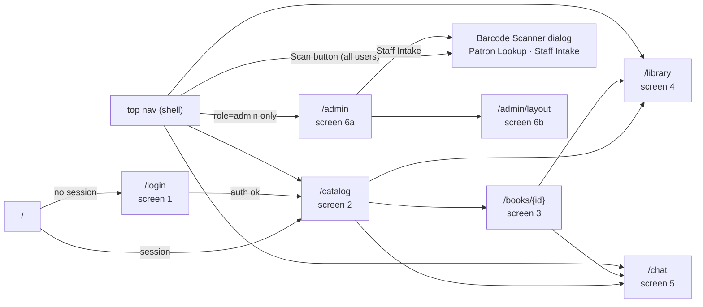

# Frontend (Next.js)

> The `web/` package: App Router page map, per-page breakdowns mapped 1:1 to Stitch screen IDs, ShadCN component usage, auth context, SSE chat client, admin pages, and loading/empty/error conventions — endpoints in [03-api-spec.md](./03-api-spec.md), design system in [12-ui-design.md](./12-ui-design.md).

## Contents

1. [Stack & Folder Layout](#1-stack--folder-layout)
2. [Page Map](#2-page-map)
3. [Stitch Route Mapping](#3-stitch-route-mapping)
4. [Auth Context & Guards](#4-auth-context--guards)
5. [Data-fetching Conventions](#5-data-fetching-conventions)
6. [Chat Streaming Client](#6-chat-streaming-client)
7. [Page Breakdowns](#7-page-breakdowns)
8. [ShadCN Component Usage](#8-shadcn-component-usage)
9. [Loading, Empty & Error States](#9-loading-empty--error-states)

## 1. Stack & Folder Layout

Next.js 15 (App Router, React 19), TypeScript, Tailwind CSS + ShadCN UI, Lucide
icons, `barcode-detector` ([11](./11-barcode-scanning.md)), **next-intl** for EN/zh-CN
localization ([14](./14-localization.md)), Playwright for E2E ([09 §8](./09-development.md#8-testing-strategy)).
Package manager: pnpm. Design tokens land in `tailwind.config.ts` + `globals.css`
([12 §tokens](./12-ui-design.md#3-design-tokens)).

```bash
web/
├── app/
│   ├── layout.tsx                # AppShell: top nav + footer (12 §app shell)
│   ├── page.tsx                  # redirect → /catalog (or /login)
│   ├── login/page.tsx            # screen 1 — no shell
│   ├── catalog/page.tsx          # screen 2
│   ├── books/[id]/page.tsx       # screen 3
│   ├── library/page.tsx          # screen 4
│   ├── chat/page.tsx             # screen 5
│   ├── admin/page.tsx            # screen 6a
│   └── admin/layout/page.tsx     # screen 6b
├── components/
│   ├── ui/                       # ShadCN primitives
│   ├── language-toggle.tsx       # EN ⇄ 中文 (14 §9)
│   ├── book-card.tsx             # domain composites (12 §component hierarchy)
│   ├── book-location-card.tsx
│   ├── ai-citation-card.tsx
│   ├── library-row-item.tsx
│   ├── building-tree-browser.tsx
│   ├── real-time-audit-stream.tsx
│   ├── command-palette.tsx       # ⌘K
│   └── barcode-scanner/          # universal dialog: Patron Lookup + Staff Intake (11)
├── i18n/request.ts               # locale resolution (14 §4)
├── messages/{en,zh-CN}.json      # catalogs (14 §5)
├── lib/{api-server.ts, api-client.ts, auth.ts, sse.ts}
├── hooks/{use-chat-stream.ts, use-barcode-scanner.ts, use-voice-input.ts}
├── e2e/                          # Playwright specs (09 §8)
├── providers/{auth-provider.tsx, theme-provider.tsx}
├── playwright.config.ts
├── middleware.ts
└── package.json
```

## 2. Page Map



Route guard (`web/middleware.ts`): missing `athenaeum_at` + `athenaeum_rt` cookies →
302 `/login?next={path}`; authenticated users requesting `/login` → `/catalog`.
Token expiry mid-session: single refresh retry ([04-auth.md](04-auth.md#7-roles--route-protection)).

## 3. Stitch Route Mapping

Source manifest: `.artifacts/stitch/stitch-manifest.json` (project
`projects/4345961817697568978` — "Athenaeum: Smart Library System"). Visual specs +
embedded gallery: [12-ui-design.md](./12-ui-design.md#7-stitch-screen-gallery).

| Route | Stitch screen ID | Stitch title | Export |
| --- | --- | --- | --- |
| `/login` | `b6e00ec93bff4f7dbabfeefcaad1166e` | Sign In - Athenaeum Library | ✅ [screen.png + code.html](../.artifacts/stitch/sign_in_athenaeum_library/) |
| `/catalog` | `e9f24637e3da43c68aa771390938f8c4` | Catalog Browser - Athenaeum Library | ✅ [code.html](../.artifacts/stitch/catalog_browser_athenaeum_library/) (PNG pending) |
| `/books/[id]` | `723960ca2605417eb085f6e17a579bd2` | Book Detail: Dune - Athenaeum Library | ✅ [code.html](../.artifacts/stitch/book_detail_dune_athenaeum_library/) (PNG pending) |
| `/library` | `9cee348492a04f3a98ab9ddb2c791258` | My Library - Athenaeum Library | ✅ [code.html](../.artifacts/stitch/my_library_athenaeum_library/) (PNG pending) |
| `/chat` | `70530f16d81642aa8d5784fe09076e11` | AI Librarian - Athenaeum Library | ✅ [code.html](../.artifacts/stitch/ai_librarian_athenaeum_library/) (PNG pending) |
| `/admin` + `/admin/layout` | `3177da5282a94617b61e9333d4446237` | Admin Portal - Athenaeum Library | ⚠️ not exported (signed URLs in manifest) |
| (early variant, unused route) | `77ccd1faf39d423cbbae00544f8f04b9` | Athenaeum Library Catalog & Wayfinding System | ⚠️ not exported — provenance only |

Export state: HTML exported for all five patron-facing screens (`.artifacts/stitch/*_athenaeum_library/code.html`), sign-in PNG included; Admin Portal + draft variant + four screenshots pending (export notes: [12 §7.1.1](12-ui-design.md#711-stitch-mcp-tool-verification--export-runbook)).

Discrepancy notes (Stitch = visual source of truth; DESIGN.md = spec source; verified against exported HTML):

- **Admin**: Stitch produced ONE screen (Admin Portal) covering both `/admin` and
  `/admin/layout` patterns; implement as two pages reusing the same components.
  > ⚠️ TODO: Verify against DESIGN.md — split confirmed at implementation time.
- **Login**: role-switcher tabs + `disabled` WeChat button verified in the export;
  the Shibboleth/SAML SSO row survives only as an HTML comment in the export —
  render nothing for it (scope: [10](10-roadmap.md)).
- **Catalog**: availability facet wording in the export is "In Building"
  (DESIGN.md: "Only Available in Building") — same behavior, implement the
  `availability=available` filter ([03 §5.1](03-api-spec.md#51-get-apibookssearch)).

## 4. Auth Context & Guards

- `providers/auth-provider.tsx` fetches `GET /api/auth/me` on mount and exposes
  `{ user, isAdmin, loading, signOut() }`; shell renders conditionally (screens
  2–6) vs the bare login layout (screen 1).
- `lib/api-server.ts` — server components: read `athenaeum_at` from
  `next/headers`, forward as `Cookie` to the API base URL (`API_BASE_URL` env).
- `lib/api-client.ts` — client `fetch` wrapper: same-origin `/api/*` proxy;
  single 401→`POST /api/auth/refresh` retry →
  on second 401 `router.push('/login?reason=expired')`.
- Admin routes (`/admin*`) render `FORBIDDEN` state instead of nav link when
  `user.role !== 'admin'` (server middleware re-checks; [04 §7](04-auth.md#7-roles--route-protection)).

## 5. Data-fetching Conventions

| Concern | Decision |
| --- | --- |
| Initial page data | Server Components `fetch()` (books, library, admin tree) |
| Client mutations | plain `fetch` in handlers + `router.refresh()` |
| Search state | URL query params are the state (shareable `/catalog?q=…&mode=hybrid`) |
| Global store | none — React context only for auth + theme |
| Polling | audit stream `GET /api/admin/copy-events?since=…` every 3 s (WebSockets out of scope — [10](./10-roadmap.md)) |
| Keys/exports | `lib/api-client.ts` exports typed functions mirroring [03-api-spec.md](./03-api-spec.md) route-for-route |

## 6. Chat Streaming Client

`EventSource` cannot POST — use `fetch` + `ReadableStream` parser in
`hooks/use-chat-stream.ts` (event contract: [06 §6](06-ai-rag.md#6-sse-event-contract)).

```ts
const res = await fetch("/api/chat", {
  method: "POST",
  headers: { "Content-Type": "application/json" },
  body: JSON.stringify({ conversation_id, message, locale }),   // locale from the cookie (14 §10)
});
const reader = res.body!.getReader();
const decoder = new TextDecoder();
let buf = "";
while (true) {
  const { value, done } = await reader.read();
  if (done) break;
  buf += decoder.decode(value, { stream: true });
  for (const evt of parseSSE(buf)) {        // splits on \n\n, parses event:/data:
    if (evt.event === "token") appendToken(evt.data.text);
    else if (evt.event === "citations") setCitations(evt.data.citations);
    else if (evt.event === "done") finalize(evt.data);
    else if (evt.event === "error") showError(evt.data);
  }
  buf = "";
}
```

## 7. Page Breakdowns

Stitch IDs above; payload contracts listed in [03-api-spec.md](./03-api-spec.md).
All routes except `/login` render inside the app shell ([12 §app shell](12-ui-design.md#6-app-shell--navigation)).

### /login — screen 1 (Stitch `b6e00ec9…`)

Role switcher tabs (Patron/Faculty/Staff — visual only, all open the same form),
email input with inline validation beacon, password field, Google SSO anchor
(`GET /api/auth/google`), disabled WeChat button, spotlight preview card linking to
`/catalog` preview data. Success → `?next` param or `/catalog`
([04-auth.md](04-auth.md#2-emailpassword-flow)).

### /catalog — screen 2 (Stitch `e9f24637…`)

Tri-modal search switcher (Keyword/Semantic/Hybrid — `mode` param), faceted
sidebar (sections [02 §5](02-data-model.md#5-indexes), availability toggle, era
buckets), `BookCard` 2:3 grid with availability beacons, `⌘K`
`command-palette.tsx` calling the same search endpoint. URL params drive state.
The shell **Scan** button opens ISBN lookup from here (and everywhere else — see
[Scanner dialog](#scanner-dialog--patron-lookup--staff-intake)).

### /books/[id] — screen 3 (Stitch `723960ca…`)

40/60 split: jacket + Ask-AI link (`/chat?prefill={title}`) + bibliographic
metadata; tri-state availability banner; `BookLocationCard` ladder (localized from `wayfinding.parts`, [14 §6.1](14-localization.md#61-wayfinding-vocabulary))
([05 §5](05-building-layout.md#5-book-detail-screen-stitch)); copy manifest table;
`neighbors` affinity carousel; waitlist join on the banner's suggested_actions
([03 §6.3](03-api-spec.md#63-waitlist)).

### /library — screen 4 (Stitch `9cee3484…`)

4 KPI cards (In Collection / Currently Reading / Completed / Bookmarks & AI),
reading-stage tabs (All/Reading/Read/Want to Read/Favorites/Holds & Waitlists —
`GET /api/library?status=…`), `LibraryRowItem` rows (shelf coordinates, progress,
rating), hold rows from `GET /api/waitlist`, AI cross-reference banner →
`/chat?prefill=my-library`. A **Scan to return** action opens the shared
[Barcode Scanner dialog](#scanner-dialog--patron-lookup--staff-intake) in Patron Lookup mode.

### /chat — screen 5 (Stitch `70530f16…`)

Two-pane: conversations drawer (`GET /api/chat/conversations`, create/delete) +
active stream. `AICitationCard`s (2:3 `BookCover` thumbnail from `cover_url`, placeholder when
null) render `citations` events live and each assistant message's persisted `citations` when
history loads ([06 §7](./06-ai-rag.md#7-conversation-persistence)); telemetry meta bar
shows model + latency; quota meter consumes `meta`/`done` rate data — daily limit
50 ([03 §2](03-api-spec.md#2-rate-limiting)). SSE client: [§6](#6-chat-streaming-client).
The composer also carries the **voice mic toggle** (push-to-talk → composer, [15 §2](./15-voice-input.md#2-ux--push-to-talk));
while recording, the live partial transcript shows as muted **ghost text inside the textarea** after the typed
draft (aria-hidden mirror layer, never part of the textarea value; Esc cancels and clears it;
[15 §2a](./15-voice-input.md#2a-live-interim-transcript));
requests send the active `locale` for AI reply language ([14 §10](./14-localization.md#10-ai-reply-language)).
Assistant replies render as **Markdown** (`components/markdown.tsx`: `react-markdown` + GFM — headings,
lists, bold/italic, inline/block code, tables, links; raw HTML is escaped and images are dropped;
`/…` links use the router, external links open in a new tab with `noopener noreferrer`) and carry a
**Copy reply** button. The composer has a **microphone picker** (saved in `localStorage`, re-found by
label if the device id rotates) with a live input-level meter while recording
([15 §2](./15-voice-input.md#2-ux--push-to-talk)); the ⌘K palette rows also show cover thumbnails.

### /admin — screen 6a (Stitch `3177da52…`)

Executive KPI grid (`GET /api/admin/data`), recent `copy_events` via
`RealTimeAuditStream` (3 s poll), quick nav to layout manager and the shared
Barcode Scanner dialog opened on its **Staff Intake** tab
([Scanner dialog](#scanner-dialog--patron-lookup--staff-intake), [11](./11-barcode-scanning.md#6-component-structure)).

### /admin/layout — screen 6b (Stitch `3177da52…`)

`BuildingTreeBrowser` tree (GET `/api/admin/tree` — drill-down to shelf), right
`shelf manifest inspector` panel (GET `/api/admin/shelves/{id}`, slot occupancy
meter, quick-assign input for barcodes — mutates `PATCH /api/admin/copies/{id}`),
floor mini-map (simple SVG grid highlighting the selected aisle).

### Scanner dialog — Patron Lookup / Staff Intake

One `BarcodeScannerDialog` (`components/barcode-scanner/`, Client Component `ssr:false` — Stitch
artifact `.artifacts/stitch/barscanner_ISBN/`) mounted in the app shell. Opened from the top-nav
**Scan** button (all users, default **Patron Lookup**), from `/library` as "Scan to return", and
from `/admin` on the **Staff Intake** tab (admin only). Behaviour + error states:
[11 §7/§8](./11-barcode-scanning.md#7-uiux-specification).

- **Patron Lookup** — each decode calls `POST /api/books/scan`
  ([03 §5.4](03-api-spec.md#54-post-apibooksscan)). An ISBN result shows the record, shelf ladder
  and other-copy availability with **View Full Record & Map** (→ `/books/{id}`) and the waitlist CTA
  when `available_copies == 0`; a copy-tag result shows the copy and, when `returnable`, a
  **Return this copy** action calling `POST /api/copies/{id}/return`
  ([03 §6.4](03-api-spec.md#64-post-apicopiesidreturn)). Camera + manual code input.
- **Staff Intake** — the Add-Book flow (Manual / ISBN / Scan tabs) driving
  `POST /api/books/fetch-isbn` → Add-Book form → `POST /api/admin/books` (+ `/api/admin/copies`).
  RFID encode / label print / Edit-MARC are **not** implemented
  ([11 §11](./11-barcode-scanning.md#11-scope-impact)).

## 8. ShadCN Component Usage

Primitive mapping synonyms listed in [12 §ShadCN mapping](12-ui-design.md#11-shadcn-mapping).
Usage per page:

| Component | Pages | Purpose |
| --- | --- | --- |
| `Button` (primary/secondary/ghost/destructive) | all | CTAs, tabs submit |
| `Input`, `Label`, `Form` | login, admin forms, quick-assign | validation per [03 §9](03-api-spec.md#9-error-catalog) |
| `Tabs` + `TabsList` | login role switcher, catalog modes, library stages, scanner dialog modes | segmented switchers |
| `Card` | everywhere | surfaces w/ `shadow-sm border` |
| `Badge` | status beacons, section dots, call-number mono chips | [12 §badges](12-ui-design.md#3-design-tokens) |
| `Alert` | tri-state banner, waitlist notices | destructive/warning/success variants |
| `Command` (+Dialog) | ⌘K palette | client-only quick search |
| `Dialog` / `Sheet` | Barcode Scanner dialog (Patron Lookup / Staff Intake), citation card details, shelf inspector | focus-trapped (Radix) |
| `Table` | copy manifest, admin books/users | mono numerics |
| `Skeleton` | loading states ([§9](#9-loading-empty--error-states)) | shimmer |
| `Toast` (sonner) | mutations, 409 waitlist hints | error surface |
| `Select` / `Slider` | era buckets, per_page, rating | |

## 9. Loading, Empty & Error States

**Destructive actions are confirmed.** Deleting a chat, removing a book from My Library and leaving a
waitlist open `ConfirmDialog` (`role="alertdialog"`, Cancel focused first, Escape/overlay cancel, copy
under the `confirm.*` catalog keys in both locales). New destructive UI must use it.

| State | Convention |
| --- | --- |
| Initial load | server component skeletons (`Skeleton`) per section — no spinners |
| Empty search | pill-style "No volumes matched" + suggested nearby sections |
| Empty library tab | CTA card → `/catalog` |
| Empty chat history | prompt chips (seeded sample questions) |
| 401 → refresh fail | redirect `/login?reason=expired` (toast) |
| 403 | inline FORBIDDEN panel |
| 404 book | full-page "Not in this building's catalog" + back to catalog |
| 409 `BOOK_NOT_AVAILABLE` | banner swaps to waitlist CTA (suggested_actions rendered literally) |
| Scan — not in catalog | "Not in this building's catalog" card (staff: Staff Intake CTA) |
| Return 409 `CONFLICT` | toast with `current_status`; result refreshes to the copy's real state |
| 429 | toast with remaining time from `X-RateLimit-Reset` |
| 5xx / SSE `error` event | toast + retry affordance; streaming keeps partial tokens on screen |
| Offline | navigator.onLine banner (best effort) |

Skeletons are in-page `<Suspense>` boundaries (`/catalog` results, `/library` KPIs/tabs/list,
`/chat` workspace) — **no route-level `loading.tsx`** (it froze soft navigation in Next 15.5
prod). Thrown server errors land in `app/(shell)/error.tsx` / `app/error.tsx` (inline panel +
retry); unknown URLs render `app/not-found.tsx` (404).

Playwright E2E coverage for the six routes + key journeys is **in v1 scope** — suite,
stubbing harness, and `make e2e` in [09 §8](./09-development.md#8-testing-strategy);
localization and voice flows add specs per [14 §12](./14-localization.md#12-testing) and
[15 §9](./15-voice-input.md#9-testing).
