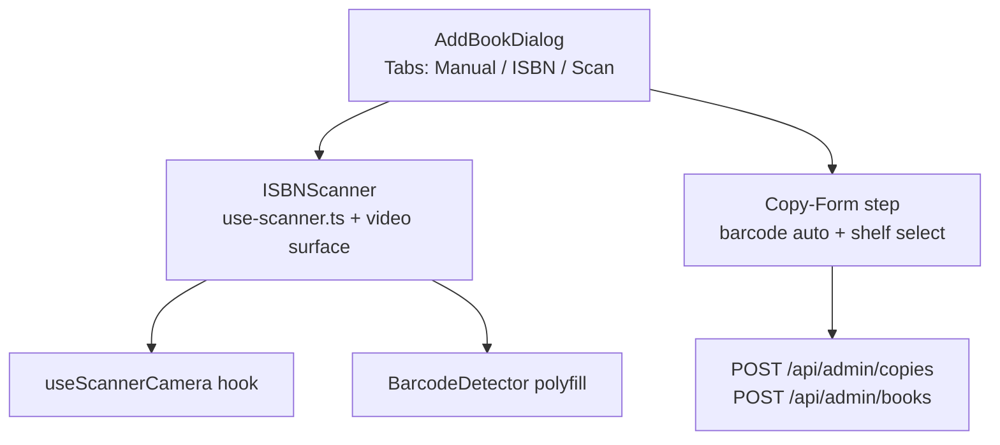

# Barcode Scanning (Book Intake)

> Frontend-only camera barcode scanning (EAN-13/ISBN) feeding `POST /api/books/fetch-isbn`, with server-side checkdigit verification — lives in the admin "Add Book" dialog; endpoint in [03-api-spec.md](./03-api-spec.md#53-post-apibooksfetch-isbn), page wiring in [07-frontend.md](./07-frontend.md#admin--screen-6a-stitch-3177da52).

## Contents

1. [Overview](#1-overview)
2. [Scan Flow](#2-scan-flow)
3. [Library Choice](#3-library-choice)
4. [Comparison](#4-comparison)
5. [Next.js Integration](#5-nextjs-integration)
6. [Component Structure](#6-component-structure)
7. [UI/UX Specification](#7-uiux-specification)
8. [Error Handling](#8-error-handling)
9. [Backend Validation](#9-backend-validation)
10. [Mobile Considerations](#10-mobile-considerations)
11. [Scope Impact](#11-scope-impact)

## 1. Overview

- Purpose: catalogers add physical books by scanning the volume's ISBN barcode
  (EAN-13) instead of typing.
- **Frontend-only feature**: the scanner produces an ISBN-13 string and hands it to
  `POST /api/books/fetch-isbn` ([03 §5.3](03-api-spec.md#53-post-apibooksfetch-isbn));
  the backend has no camera logic, only validation.
- Location: `web/components/isbn-scanner/`, rendered as a **tab inside the admin
  "Add Book" dialog** on `/admin` ([07](07-frontend.md#admin--screen-6a-stitch-3177da52),
  screen 6 Stitch ID `3177da52…`). Demo note: modern smartphone with PDAF autofocus (e.g.
  Redmi Note 15) is recommended over laptop webcams for reliability ([§10](#10-mobile-considerations)).

## 2. Scan Flow

```mermaid
sequenceDiagram
    autonumber
    participant C as Camera getUserMedia
    participant S as ISBNScanner client comp
    participant D as BarcodeDetector polyfill
    participant A as api POST /api/books/fetch-isbn
    participant OL as Open Library

    S->>C: request stream: facingMode environment
    C-->>S: MediaStream video track
    S->>D: detect(videoFrame) every 200 ms
    D-->>S: result rawValue "9780441013593" format ean_13
    S->>S: local EAN-13 checkdigit pre-check
    S->>A: POST isbn (10 per min per user)
    A->>OL: metadata lookup (3 s timeout)
    OL-->>A: normalized record (fallback: docs/08 §6)
    A-->>S: 200 book fields source openlibrary
    S->>S: haptics vibrate(50) + confirmation beep
    S-->>Dialog: prefill Add Book form; cataloger confirms
```

Offline/no-camera is a legitimate state — the manual ISBN input in the same
dialog remains the fallback path ([§8](#8-error-handling)).

## 3. Library Choice

`barcode-detector` npm package: a polyfill for the Web `BarcodeDetector` API
backed by the ZXing-C++ WebAssembly build ([npm: barcode-detector](https://www.npmjs.com/package/barcode-detector)).
On Chromium/Android the native implementation is used automatically; Safari/Firefox
run the WASM polyfill — one code path, `BarcodeDetector` interface either way.

| Criterion | Why it matters here |
| --- | --- |
| Standard-shaped API | `new BarcodeDetector({ formats })` — no bespoke glue, future-proof |
| ZXing-C++ WASM backend | strong multi-format decode quality incl. EAN-13 |
| Wheels: ships WASM binary | no service worker hacks |
| Maintained by zxing org contributors | actively updated |
| SSR constraints | requires dynamic import — handled explicitly ([§5](#5-nextjs-integration)) |

Restricted formats: `formats: ['ean_13']` scanning profile (ISBN barcodes are
EAN-13). The `isbn` format label is display-only in the UX copy.

## 4. Comparison

| Library | API | WASM dependency | EAN-13 | Maintenance | SSR | Notes |
| --- | --- | --- | --- | --- | --- | --- |
| `barcode-detector` | Web-standard `BarcodeDetector` | optional (native) / included | ✅ best | active (zxing org) | needs `ssr:false` | chosen |
| `zxing-wasm` (raw) | JS classes | included | ✅ | active | fine | more glue for camera loop |
| `html5-qrcode` | bespoke UI | js bundle | ✅ | stale | fine | drags its own UI, not composable |
| Native `BarcodeDetector` only | standard | none | ✅ Chromium/Android only | browser | fine | Safari/Firefox gap |

## 5. Next.js Integration

The scanner runs in the browser only (getUserMedia + WASM), so it is loaded as a
**Client Component with `ssr: false`**:

```tsx
// web/app/admin/page.tsx (Admin screen 6a)
"use client";
import dynamic from "next/dynamic";

const ISBNScanner = dynamic(
  () => import("@/components/isbn-scanner").then((m) => m.ISBNScanner),
  { ssr: false, loading: () => <Skeleton className="h-64 w-full" /> }
);
```

Camera loop essentials:

```ts
// web/components/isbn-scanner/use-scanner.ts
const detector = new BarcodeDetector({ formats: ["ean_13"] });
const stream = await navigator.mediaDevices.getUserMedia({
  video: { facingMode: { ideal: "environment" }, width: { ideal: 1920 } },
  audio: false,
});
video.srcObject = stream;                 // <video playsInline muted autoplay>
const loop = async () => {
  if (video.currentTime !== lastT) {
    const hits = await detector.detect(video);
    if (hits.length) onDetected(hits[0].rawValue); // cooldown guards repeats
    lastT = video.currentTime;
  }
  rafId = requestAnimationFrame(loop);    // or requestVideoFrameCallback
};
```

- Cleanup: stop all tracks + cancel RAF on unmount/dialog close (StrictMode
  double-invoke-safe guard).
- **HTTPS in production** — `getUserMedia` is blocked on insecure origins; local
  dev uses `http://localhost` exception.

## 6. Component Structure



| Prop | Type | Purpose |
| --- | --- | --- |
| `onDetected` | `(isbn: string) => void` | parent prefill/call of fetch-isbn |
| `formats` | `['ean_13']` | restricted profile |
| `region` | bbox overlay config | scan target rectangle |
| `active` | bool | pause/resume when tab unmounts |

## 7. UI/UX Specification

| Element | Behavior |
| --- | --- |
| Dialog tab | third tab in Add-Book dialog — icon `ScanLine`, label "Scan ISBN" |
| Video surface | full-width, `aspect-video`, rounded card, mirrored when front camera |
| Scan region | corner-bracket overlay + dimmed background; EAN codes sit flat, so use a wide 3:2 region, not a 2:3 book-jacket shape |
| Preflight | "No camera access?" instruction line + Manual fallback link ([§9](#9-backend-validation)) |
| Torch toggle | `track.applyConstraints({ advanced: [{ torch: true }] })` on supported tracks |
| Camera flip | cycles `facingMode` between `environment`/`user` |
| Feedback | `navigator.vibrate(50)` (haptics), WebAudio 880 Hz 40 ms beep, green focus ring |
| Cooldown | 1.5 s lockout after a detection to prevent duplicate prefills |

## 8. Error Handling

| Scenario | Trigger | UX behavior |
| --- | --- | --- |
| Permission denied | `NotAllowedError` | explainer card + "Open camera settings" / manual input |
| No device | `NotFoundError` | "Connect a camera" + manual tab auto-select |
| Insecure origin | getUserMedia absent | banner: "Camera requires HTTPS" + manual input |
| WASM load failure | network/CDN issue | manual tab + retry button |
| Invalid checksum | local pre-check fails | red shake on the region: "Barcode unusable — scan a different surface" |
| `400 INVALID_ISBN` from API | server re-validation ([§9](#9-backend-validation)) | toast + manual-tutorial link |
| `409 ISBN_CONFLICT` from API | book exists | toast + "Open in catalog" deep link ([03 §5.3](03-api-spec.md#53-post-apibooksfetch-isbn)) |
| `429 RATE_LIMITED` (>10/min) | intake throttle | toast with reset seconds |
| UPC (12-digit) scanned | wrong barcode format | hint: that is the store barcode — scan the ISBN/EAN-13 may need barcode labels in publisher libraries |

## 9. Backend Validation

Intake endpoint re-validates with `github.com/osamingo/checkdigit` (EAN-13
verifier) — mirrors the client-side pre-check:

```go
import ean "github.com/osamingo/checkdigit/ean"

var v = ean.EAN13{} // or generic EAN verifier used per checksum table
if ok, _ := v.Verify([]byte(strings.TrimSpace(req.ISBN))); !ok {
    return model.AppError{Code: model.ErrInvalidISBN}   // -> 400 INVALID_ISBN
}
```

- Runs in `internal/service/catalog.ValidateISBN` — used by `fetch-isbn`, admin
  book creation, **and** `cmd/seed` fixture validation ([08 §4](08-seed-data.md#4-seed-algorithm)).
- Mock books all carry checksum-valid ISBNs ([13](13-mock-data-reference.md#2-book-catalog-all-40)
  shows catalog ISBN demo values precomputed checksum-valid).

## 10. Mobile Considerations

| Topic | Decision |
| --- | --- |
| Autofocus | PDAF phones focus near-instant; prefer modern handsets — Redmi Note 15 in demos; laptop webcams (fixed focus ~50 cm) work but slower |
| `playsInline` | mandatory to avoid iOS fullscreen video takeover |
| Torch/zoom | iOS apps need permission + track-capability queries before enabling |
| Desk demo setup | book at ~20–30 cm, barcode perpendicular to lens, decent ambient light |
| Front-facing mode | used for "copy that code from another screen" convenience |

## 11. Scope Impact

- **No new backend surface** beyond the existing `POST /api/books/fetch-isbn` +
  admin copy endpoints ([03 §8.3](03-api-spec.md#83-admin-copies)) — everything
  else the feature needs already exists.
- Frontend-first, contained in one dialog + one hook + one component folder; the
  camera scanner is also reusable from the `/admin/layout` quick-assign input as
  a secondary trigger ([07 §admin/layout](07-frontend.md#adminlayout--screen-6b-stitch-3177da52)).
- Pattern parity: the dialog works on tablet and 375 px mobile layouts unchanged.
