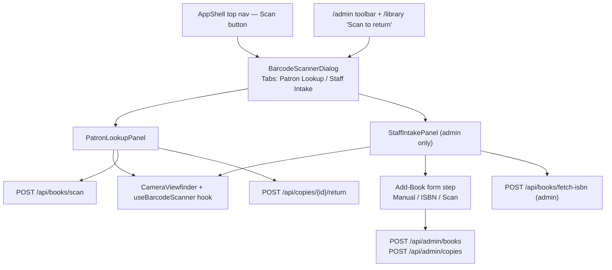

# Barcode Scanning (Universal Patron & Staff Scanner)

> Camera barcode/ISBN scanning for both audiences in one dialog: **Patron Lookup** (scan an ISBN → the record + other available copies; scan a copy tag → **self-service return**) and **Staff Intake** (scan an ISBN → add a book). Two patron endpoints plus the existing admin intake — endpoints in [03-api-spec.md](./03-api-spec.md#54-post-apibooksscan), page wiring in [07-frontend.md](./07-frontend.md#scanner-dialog--patron-lookup--staff-intake), component in [12-ui-design.md](./12-ui-design.md#9-component-hierarchy).

## Contents

1. [Overview](#1-overview)
2. [Scan Flows](#2-scan-flows)
3. [Library Choice](#3-library-choice)
4. [Comparison](#4-comparison)
5. [Next.js Integration](#5-nextjs-integration)
6. [Component Structure](#6-component-structure)
7. [UI/UX Specification](#7-uiux-specification)
8. [Error Handling](#8-error-handling)
9. [Endpoints & Validation](#9-endpoints--validation)
10. [Mobile Considerations](#10-mobile-considerations)
11. [Scope Impact](#11-scope-impact)

## 1. Overview

One **Universal Barcode & ISBN Scanner** dialog serves both audiences (Stitch artifact:
`.artifacts/stitch/barcode_isbn_scanner_athenaeum_library/`, refreshed 2026-10-16 — a bento modal;
the two-tab **Patron Lookup / Staff Intake** model is kept, decided 2026-10-16):

 - **Patron Lookup** (default; every signed-in user):
  - scan an **ISBN-13/EAN-13** → the matching catalog record, its home shelf, and **how many
    other copies are left**; CTA "View Full Record & Map", or the waitlist CTA when zero copies
    are available. When the book has `borrowable:true`, a **Borrow this book** button
    (`data-testid="scan-borrow"`) lets the patron check out immediately — the server picks
    the best available copy and the UI reveals the chosen copy tag + shelf (`scan-borrow-copy`)
    so the patron knows which item to take. When the patron already has an open loan for this
    book, **Return this book** (`data-testid="scan-return"`) closes it without needing the
    copy tag — [03 §6.8/§6.9](03-api-spec.md#68-post-apibooksidborrow).
  - scan an **Athenaeum copy tag** (`ATH-XXXXXX-CYY`) → that specific copy, with a
    **Borrow this copy** action when it is `available` (self-service checkout → a 14-day loan)
    or a **Return this copy** action when it is `checked_out` (self-service return) —
    [12 §10](12-ui-design.md#10-copy-state-machine).
- **Staff Intake** (👑 admin only): scan an ISBN → prefill the Add-Book form (existing
  behaviour), with the local copy-tag that intake will assign.

Accepted codes and their symbols:

| Code | Symbology | Resolves to |
| --- | --- | --- |
| ISBN-13 / EAN-13 (`978…`, `979…`) | EAN-13 | `books` row (via `isbn13`) |
| Athenaeum copy tag `ATH-002941-C01` | Code 128 | `book_copies` row (+ its `book_locations` path) |

- **Frontend-first, but no longer frontend-only**: the camera, decode loop and dialog are
  browser-only; ISBN lookup, self-service **borrow** and self-service **return** are patron
  endpoints ([03 §5.4](03-api-spec.md#54-post-apibooksscan) / [§6.5](03-api-spec.md#65-post-apicopiesidborrow) /
  [§6.4](03-api-spec.md#64-post-apicopiesidreturn)).
- **ISBN-10 is not supported** (out of v1): a scanned ISBN-10 fails the EAN-13 pre-check and
  surfaces as an unusable-barcode hint. Everything canonical is ISBN-13 ([02](02-data-model.md#books)).
- Demo note: a modern smartphone with PDAF autofocus (e.g. Redmi Note 15) is recommended over
  laptop webcams for reliability ([§10](#10-mobile-considerations)).

> ℹ️ The artifact's **Staff Intake** panel also sketches *RFID encode*, *thermal label print* and
> *Edit MARC*. Those stay out of v1 — see [§11](#11-scope-impact).

## 2. Scan Flows

### 2a. Patron lookup (ISBN → record + other copies; unknown ISBN → OL identification)

```mermaid
sequenceDiagram
    autonumber
    participant C as Camera getUserMedia
    participant S as Scanner client comp
    participant D as BarcodeDetector polyfill
    participant A as api POST /api/books/scan
    participant I as api POST /api/books/identify-isbn
    participant OL as Open Library (olbooks client)
    participant PG as Postgres (books + copies)

    S->>C: request stream: facingMode environment
    C-->>S: MediaStream video track
    S->>D: detect(videoFrame) every 200 ms
    D-->>S: result rawValue "9780441013593" format ean_13
    S->>S: local EAN-13 checkdigit pre-check
    S->>A: POST code (30 per min per user)
    A->>PG: books by isbn13 + copy availability
    A-->>S: 200 match=book, availability, wayfinding
    S->>S: haptics vibrate(50) + confirmation beep
    S-->>Dialog: show record; "View Full Record & Map" / waitlist CTA when 0 available

    note over S,PG: Unknown ISBN path (match=none, code_type=isbn13)
    A-->>S: 200 match=none, in_catalog=false
    S-->>Dialog: "Not registered in this library" warning (scan-not-registered); skeleton
    S->>I: POST isbn (10 per min per user; identify_isbn bucket)
    I->>PG: re-check books by isbn13 (concurrent-add guard)
    I->>OL: GET /api/books?bibkeys=ISBN:{isbn} (3s / 2 retries; Redis 24h cache)
    OL-->>I: metadata or empty/error
    I-->>S: 200 {identified:{title,authors,cover_url,…}, source, warnings}
    S-->>Dialog: identified card (scan-identified): cover + title + authors + publisher·year
    note over S,Dialog: warning banner persists regardless — "Not registered in this library"
```

### 2b. Patron self-service return (copy tag → return)

```mermaid
sequenceDiagram
    autonumber
    participant S as Scanner client comp
    participant A as api POST /api/books/scan
    participant R as api POST /api/copies/{id}/return
    participant PG as Postgres (copies + waitlist + copy_events)

    S->>A: POST code "ATH-002941-C01"
    A-->>S: 200 match=copy, copy.status=checked_out, returnable=true
    S-->>Dialog: show copy + "Return this copy"
    S->>R: POST return (10 per min per user)
    R->>PG: status checked_out -> available (or reserved_waitlist on hold turnover)
    R->>PG: append copy_events (source=self_return, actor=patron)
    R-->>S: 200 copy.status + availability (+ promoted hold)
    S-->>Dialog: success toast; "Scan Next"
```

### 2b-ii. Patron self-service borrow (copy tag → checkout)

```mermaid
sequenceDiagram
    autonumber
    participant S as Scanner client comp
    participant A as api POST /api/books/scan
    participant B as api POST /api/copies/{id}/borrow
    participant PG as Postgres (copies + loans + copy_events)

    S->>A: POST code "ATH-002941-C02"
    A-->>S: 200 match=copy, copy.status=available, borrowable=true
    S-->>Dialog: show copy + "Borrow this copy"
    S->>B: POST borrow (10 per min per user)
    B->>PG: status available -> checked_out; INSERT loans (due_at = now + 14d)
    B->>PG: append copy_events (source=self_checkout, actor=patron)
    B-->>S: 201 loan (due_at) + availability
    S-->>Dialog: success toast with due date; "Scan Next"
```

`reserved_waitlist` owned by the caller behaves like `available` (a ready hold being picked
up → the hold becomes `picked_up`). Rate 10/1min; max 5 open loans per user.

### 2b-iii. Patron borrow / return by ISBN (book-level, no copy tag needed)

```mermaid
sequenceDiagram
    autonumber
    participant S as Scanner client comp
    participant A as api POST /api/books/scan
    participant B as api POST /api/books/{id}/borrow
    participant R as api POST /api/books/{id}/return
    participant PG as Postgres (copies + loans + copy_events)

    S->>A: POST code "9780812540833"
    A-->>S: 200 match=book, borrowable=true, borrow_copy={barcode,location}, my_loans=[]
    S-->>Dialog: show book + "Borrow this book" (scan-borrow)
    S->>B: POST borrow (10 per min per user; shared copy-borrow bucket)
    B->>PG: SELECT FOR UPDATE SKIP LOCKED — lowest available copy (or caller's reserved_waitlist)
    B->>PG: status available -> checked_out; INSERT loans (due_at = now + 14d)
    B->>PG: append copy_events (source=self_checkout, actor=patron)
    B-->>S: 201 loan (due_at) + copy {barcode, location}
    S-->>Dialog: scan-borrow-copy panel: "Take copy ATH-002949-C01 from Shelf S-2 — due Oct 30"; "Scan Next"

    note over S,PG: Return path — caller already has a loan
    A-->>S: 200 match=book, returnable=true, my_loans=[{id, copy_id, barcode, due_at}]
    S-->>Dialog: show book + "Return this book" (scan-return)
    S->>R: POST return (10 per min per user; shared copy-return bucket)
    R->>PG: closes caller's oldest open loan for this book
    R->>PG: checked_out -> available; append copy_events (source=self_return)
    R-->>S: 200 closed_loan + availability
    S-->>Dialog: success toast "Returned — thanks!"; "Scan Next"
```

Rate 10/1min (shared with copy-level borrow/return buckets — [03 §2](03-api-spec.md#2-rate-limiting)).
Same 14-day loan, max 5 open loans, one renewal — all copy-tag paths remain unchanged.

### 2c. Staff intake (ISBN → add book)

Existing flow: scan → `POST /api/books/fetch-isbn` (👑 admin) → prefill Add-Book form →
`POST /api/admin/books` (+ `/api/admin/copies`). Unchanged from the v1 intake contract
([03 §5.3](03-api-spec.md#53-post-apibooksfetch-isbn)); the dialog now also surfaces the
auto-generated copy tag the server will assign.

Camera denied / no device / no camera is a legitimate state — the manual code input in the
same dialog remains the fallback path for every mode ([§8](#8-error-handling)).

## 3. Library Choice

`barcode-detector` npm package: a polyfill for the Web `BarcodeDetector` API
backed by the ZXing-C++ WebAssembly build ([npm: barcode-detector](https://www.npmjs.com/package/barcode-detector)).
On Chromium/Android the native implementation is used automatically; Safari/Firefox
run the WASM polyfill — one code path, `BarcodeDetector` interface either way.

| Criterion | Why it matters here |
| --- | --- |
| Standard-shaped API | `new BarcodeDetector({ formats })` — no bespoke glue, future-proof |
| ZXing-C++ WASM backend | strong multi-format decode quality incl. EAN-13 and Code 128 |
| Wheels: ships WASM binary | no service worker hacks |
| Maintained by zxing org contributors | actively updated |
| SSR constraints | requires dynamic import — handled explicitly ([§5](#5-nextjs-integration)) |

Scanning profile: `formats: ['ean_13', 'code_128']` — EAN-13 for ISBN barcodes, Code 128 for
the Athenaeum copy tag (`ATH-XXXXXX-CYY`, [12 §10](12-ui-design.md#10-copy-state-machine)).
Both payloads are validated again server-side: EAN-13 with the `checkdigit` verifier, the copy
tag against `^ATH-[0-9]{6}-C[0-9]{2}$` ([§9](#9-endpoints--validation)). The `isbn` format label
is display-only in the UX copy.

## 4. Comparison

| Library | API | WASM dependency | EAN-13 / Code 128 | Maintenance | SSR | Notes |
| --- | --- | --- | --- | --- | --- | --- |
| `barcode-detector` | Web-standard `BarcodeDetector` | optional (native) / included | ✅ best | active (zxing org) | needs `ssr:false` | chosen |
| `zxing-wasm` (raw) | JS classes | included | ✅ | active | fine | more glue for camera loop |
| `html5-qrcode` | bespoke UI | js bundle | ✅ | stale | fine | drags its own UI, not composable |
| Native `BarcodeDetector` only | standard | none | ✅ Chromium/Android only | browser | fine | Safari/Firefox gap |

## 5. Next.js Integration

The scanner runs in the browser only (getUserMedia + WASM), so it is loaded as a
**Client Component with `ssr: false`** and mounted in the app shell so the nav Scan
button and the admin toolbar share one instance:

```tsx
// web/components/barcode-scanner/index.tsx
"use client";
import dynamic from "next/dynamic";

export const BarcodeScannerDialog = dynamic(
  () => import("./scanner-dialog").then((m) => m.BarcodeScannerDialog),
  { ssr: false, loading: () => <Skeleton className="h-64 w-full" /> }
);
```

Camera loop essentials:

```ts
// web/hooks/use-barcode-scanner.ts
const detector = new BarcodeDetector({ formats: ["ean_13", "code_128"] });
const stream = await navigator.mediaDevices.getUserMedia({
  video: { facingMode: { ideal: "environment" }, width: { ideal: 1920 } },
  audio: false,
});
video.srcObject = stream;                 // <video playsInline muted autoplay>
const loop = async () => {
  if (video.currentTime !== lastT) {
    const hits = await detector.detect(video);
    if (hits.length) onDetected(hits[0].rawValue); // cooldown guards repeats
    lastT = video.currentTime;
  }
  rafId = requestAnimationFrame(loop);    // or requestVideoFrameCallback
};
```

- Cleanup: stop all tracks + cancel RAF on unmount/dialog close (StrictMode
  double-invoke-safe guard).
- **HTTPS in production** — `getUserMedia` is blocked on insecure origins; local
  dev uses `http://localhost` exception.
- **Self-hosted WASM** — `zxing-wasm` defaults to fetching `zxing_reader.wasm` from
  jsDelivr. The web pins `zxing-wasm` to the exact version `barcode-detector` depends on,
  emits the binary via a webpack `asset/resource` rule in `next.config.ts`
  (`/_next/static/media/zxing_reader.<hash>.wasm`) and points `prepareZXingModule`'s
  `locateFile` at it, so the ponyfill works offline/behind a CSP. Bump both together.

## 6. Component Structure



| Prop | Type | Purpose |
| --- | --- | --- |
| `open` / `onOpenChange` | bool / handler | Radix `Dialog` control (focus-trapped) |
| `mode` | `'patron' \| 'staff'` | initial tab; staff tab hidden for non-admins |
| `onDetected` | `(code: string, format: string) => void` | dispatch to the active panel resolver |
| `formats` | `['ean_13','code_128']` | restricted scanning profile |
| `region` | bbox overlay config | scan target rectangle |
| `active` | bool | pause/resume camera when the tab/dialog unmounts |

## 7. UI/UX Specification

Artifact: `.artifacts/stitch/barcode_isbn_scanner_athenaeum_library/code.html` (bento 7/5 split —
viewfinder left, telemetry + result right; refreshed 2026-10-16). Stitch is the visual source of
truth for layout; this table fixes behaviour.

> Decided 2026-10-16 — the refreshed artifact is a **superset sketch** whose extra affordances are
> **not** adopted: the three-way **Borrow / Return / Add to DB** mode selector (we keep the two tabs
> Patron Lookup / Staff Intake, with Borrow/Return as actions inside Patron Lookup); **ISBN-10**
> support (still out — a scanned ISBN-10 fails the EAN-13 pre-check); **RFID encode / Print Tag**
> (deferred); and its loan copy ("21-day loan", "quota of 6") — the canonical values are the
> **14-day loan, max 5** of [03 §6.5](03-api-spec.md#65-post-apicopiesidborrow).

| Element | Behavior |
| --- | --- |
| Mode switcher | segmented `Patron Lookup` / `Staff Intake`; Staff carries a `STAFF` badge and is hidden for non-admins |
| Video surface | full-width, `aspect-[4/3]` → `16/10`, rounded card, mirrored when front camera |
| Scan region | corner-bracket overlay + dimmed background; wide 3:2 region (EAN codes sit flat; the ATH tag is a short 1D symbol) |
| Viewfinder HUD | camera-active telemetry + decoder status (decorative; `aria-hidden`) |
| Torch toggle | `track.applyConstraints({ advanced: [{ torch: true }] })` on supported tracks |
| Camera flip | cycles `facingMode` between `environment`/`user` |
| Feedback | `navigator.vibrate(50)` (haptics), WebAudio 880 Hz 40 ms beep, green focus ring |
| Cooldown | 1.5 s lockout after a detection to prevent duplicate lookups |
| Manual fallback | text input accepting an ISBN-13 or `ATH-…` tag, with a client check-digit hint ([§8](#8-error-handling)) |
| Result — book | cover (2:3), title/author, ISBN, call numbers; availability chip (`N Copies on Shelf`); shelf coordinates block; **Borrow this book** (`data-testid="scan-borrow"`) when `borrowable:true` — after success, `scan-borrow-copy` panel names the chosen copy barcode + shelf + due date; **Return this book** (`data-testid="scan-return"`) when `returnable:true` (patron has an open loan for this book). When not borrowable and `available_copies==0`: waitlist CTA. |
| Result — copy | copy `barcode`, status, condition, shelf coordinates, and the open loan's due date when borrowed by the caller; **Borrow this copy** when `borrowable`, **Return this copy** when `returnable` |
| Result — not in library | Persistent amber/destructive `role="status"` warning banner: "Not registered in this library — this title isn't in the catalog." (`data-testid="scan-not-registered"`, key `scanner.notInCatalog.warning`). While OL identification is in flight: loading skeleton (`scanner.notInCatalog.identifying`). When identified: cover image via `BookCover` using OL `cover_url` (`data-testid="scan-identified-cover"`), title (`data-testid="scan-identified-title"`), authors, publisher · year — wrapper `data-testid="scan-identified"` — attributed as `scanner.notInCatalog.identifiedBy`. When OL has no record or is offline: generic unidentified text (`scanner.notInCatalog.unidentified`). If the ISBN was added to the catalog between the scan and the identification response: warning swaps to "View Full Record" (`scanner.notInCatalog.alreadyAdded`). Staff sees the existing "Add this book (Staff Intake)" CTA regardless. |
| Patron actions — ISBN book match | `View Full Record & Map` → `/books/{id}`; **Borrow this book** (`scan-borrow`, when `borrowable`) → loan created via [03 §6.8](03-api-spec.md#68-post-apibooksidborrow); `scan-borrow-copy` panel shows the chosen copy tag + shelf + due date; **Return this book** (`scan-return`, when `returnable`) → [03 §6.9](03-api-spec.md#69-post-apibooksidreturn); `Scan Next` (clears result, keeps camera) |
| Patron actions — copy-tag match | `Borrow this copy` → loan with due date ([03 §6.5](03-api-spec.md#65-post-apicopiesidborrow)); `Return this copy` → [03 §6.4](03-api-spec.md#64-post-apicopiesidreturn); `Scan Next` |
| Staff module | next inventory copy tag (`ATH-…-CY`), commit intake → Add-Book form |
| Staff intake form | after ISBN lookup the form shows a live **cover preview** (`intake-cover-preview`, from the editable `cover_url`) beside title/authors/publisher/year; a **Shelving** group makes **Section** and **Shelf** required (inline errors `err-section`/`err-shelf`; shelf list is filtered by the chosen section; copies 1–20); catalog numbers/description sit in a collapsible. No "prefilled" banner — only an Open-Library-had-no-record notice when the lookup is partial. |

## 8. Error Handling

| Scenario | Trigger | UX behavior |
| --- | --- | --- |
| Permission denied | `NotAllowedError` | explainer card + "Open camera settings" / manual input |
| No device | `NotFoundError` | "Connect a camera" + manual input auto-focus |
| Insecure origin | getUserMedia absent | banner: "Camera requires HTTPS" + manual input |
| WASM load failure | network/CDN issue | manual input + retry button |
| Invalid checksum | local pre-check fails | red shake on the region: "Barcode unusable — scan a different surface" |
| ISBN-10 scanned | non-EAN-13 ISBN | hint: ISBN-10 is unsupported — scan the ISBN-13/EAN-13 barcode |
| UPC (12-digit) scanned | wrong barcode format | hint: that is the store barcode — scan the ISBN/EAN-13 (publisher libraries may need barcode labels) |
| `400 INVALID_ISBN` from API | server re-validation ([§9](#9-endpoints--validation)) | toast + manual-input hint |
| `200 in_catalog:false, match:none, code_type:isbn13` | ISBN validates but no local row | Renders the "not in library" warning card immediately (`scan-not-registered`); then calls `POST /api/books/identify-isbn` ([03 §5.5](03-api-spec.md#55-post-apibooksidentify-isbn)) once to fill in the OL metadata (cover/title/authors/publisher·year via `scan-identified`). While identifying: loading skeleton. If OL is down or has no record: generic unidentified text (`scan-not-registered` persists). Staff Intake CTA stays visible regardless. |
| `409 CONFLICT` on return (copy tag) | copy is not `checked_out` | toast showing `current_status`; result refreshes to the copy's real state |
| `409 CONFLICT` on borrow-by-book | no available copy | toast "No available copy to borrow right now"; scanner stays on the book card |
| `409 CONFLICT` on return-by-book | caller has no open loan for this book | toast "No open loan found"; result updates to show current `my_loans` state |
| `409 BORROW_LIMIT` | caller already has 5 loans | toast "Loan limit reached (5)" |
| `404 NOT_FOUND` on return | copy/book removed between scan and return | toast + "Scan Next" |
| `429 RATE_LIMITED` | scan/return/borrow throttle | toast with reset seconds |
| `409 ISBN_CONFLICT` (staff) | ISBN already in catalog | toast + "Open in catalog" deep link ([03 §5.3](03-api-spec.md#53-post-apibooksfetch-isbn)) |

## 9. Endpoints & Validation

| Endpoint | Auth | Purpose |
| --- | --- | --- |
| `POST /api/books/scan` | 🔒 user | resolve a scanned ISBN / copy tag locally (no upstream) — [03 §5.4](03-api-spec.md#54-post-apibooksscan) |
| `POST /api/copies/{id}/borrow` | 🔒 user | self-service checkout (available/reserved→own → checked_out + loan) — [03 §6.5](03-api-spec.md#65-post-apicopiesidborrow) |
| `POST /api/copies/{id}/return` | 🔒 user | self-service return (checked_out → available / reserved_waitlist) — [03 §6.4](03-api-spec.md#64-post-apicopiesidreturn) |
| `POST /api/copies/{id}/renew` | 🔒 user | renew an open loan once (+14d) — [03 §6.6](03-api-spec.md#66-post-apicopiesidrenew) |
| `POST /api/books/identify-isbn` | 🔒 user | identify an unknown ISBN via Open Library (patron, called after scan `match:none`) — [03 §5.5](03-api-spec.md#55-post-apibooksidentify-isbn) |
| `POST /api/books/{id}/borrow` | 🔒 user | borrow by book — server picks copy (lowest available barcode, or caller's own `reserved_waitlist` first) — [03 §6.8](03-api-spec.md#68-post-apibooksidborrow) |
| `POST /api/books/{id}/return` | 🔒 user | return by book — closes caller's oldest open loan for the book — [03 §6.9](03-api-spec.md#69-post-apibooksidreturn) |
| `POST /api/books/fetch-isbn` | 👑 admin | metadata intake for a **new** book — [03 §5.3](03-api-spec.md#53-post-apibooksfetch-isbn) |
| `POST /api/admin/books/{id}/isbns` | 👑 admin | attach edition ISBN to book — [03 §8.6](03-api-spec.md#86-admin-isbn-management--merge) |
| `DELETE /api/admin/books/{id}/isbns/{isbn13}` | 👑 admin | detach non-primary edition ISBN — [03 §8.6](03-api-spec.md#86-admin-isbn-management--merge) |
| `POST /api/admin/books/{id}/merge` | 👑 admin | merge source into target book — [03 §8.6](03-api-spec.md#86-admin-isbn-management--merge) |
| `POST /api/admin/books` · `/api/admin/copies` | 👑 admin | staff create book / copy (auto copy tag) — [03 §8](03-api-spec.md#8-admin) |

Checksum validation is shared: EAN-13 via `github.com/osamingo/checkdigit` and the copy tag by
regex, both mirrored client-side as best effort:

```go
import ean "github.com/osamingo/checkdigit/ean"

var v = ean.EAN13{}
if ok, _ := v.Verify([]byte(strings.TrimSpace(code))); !ok {
    return model.AppError{Code: model.ErrInvalidISBN}   // -> 400 INVALID_ISBN
}
```

- Runs in `internal/service/catalog` — used by `scan`, `fetch-isbn`, admin book creation,
  **and** `cmd/seed` fixture validation ([08 §4](08-seed-data.md#4-seed-algorithm)).
- Mock books all carry checksum-valid ISBNs ([13](13-mock-data-reference.md#2-book-catalog-all-40)).
- The copy tag is matched (case-insensitively, uppercased) against
  `^ATH-[0-9]{6}-C[0-9]{2}$`; a valid-shaped but unknown tag → `200 in_catalog:false`.

## 10. Mobile Considerations

| Topic | Decision |
| --- | --- |
| Autofocus | PDAF phones focus near-instant; prefer modern handsets — Redmi Note 15 in demos; laptop webcams (fixed focus ~50 cm) work but slower |
| `playsInline` | mandatory to avoid iOS fullscreen video takeover |
| Torch/zoom | iOS apps need permission + track-capability queries before enabling |
| Desk demo setup | book at ~20–30 cm, barcode perpendicular to lens, decent ambient light |
| Front-facing mode | used for "copy that code from another screen" convenience |

## 11. Scope Impact

- **New backend surface (v1 scope expansion):** `POST /api/books/scan`,
  `POST /api/copies/{id}/borrow`, `POST /api/copies/{id}/return` and
  `POST /api/copies/{id}/renew`, plus `GET /api/loans` and a patron-facing read of
  `book_locations` ([10 §1](10-roadmap.md#1-in-scope-v1--checklist) items 16-17).
  `POST /api/books/identify-isbn` ([03 §5.5](03-api-spec.md#55-post-apibooksidentify-isbn)) is
  the patron Open Library lookup — called **only** after a scan miss for an ISBN-13; it is
  separate from the scan bucket and never blocks the not-in-catalog card render.
  `POST /api/books/{id}/borrow` and `POST /api/books/{id}/return` ([03 §6.8/§6.9](03-api-spec.md#68-post-apibooksidborrow))
  extend borrowing and return to the **ISBN scan path** — no copy tag required;
  the server picks the best copy. Admin ISBN attachment and book merge use
  [03 §8.6](03-api-spec.md#86-admin-isbn-management--merge).
  `fetch-isbn` stays the admin intake path.
- **Self-service borrow and return are trust-based circulation:** scanning an ISBN or a copy
  tag borrows an `available` copy (14-day loan, max 5, one renewal) or returns a `checked_out`
  copy — no borrower card scan ([01 §8](01-architecture.md#8-cross-cutting-rules)). Copy-tag
  paths target a specific copy; book-level paths let the server pick. The borrower and `due_at`
  live in [`loans`](02-data-model.md#loans). Overdue **fines**, reminders and multi-copy hold
  requests remain deferred ([10 §2](10-roadmap.md#2-out-of-scope--deferred)).
- Frontend: one dialog folder (`web/components/barcode-scanner/`), one hook
  (`use-barcode-scanner.ts`), one nav entry — reused by `/catalog`, `/library`, and `/admin`;
  the `/library` **Loans** tab lists active loans with due dates.
- Pattern parity: the dialog works on tablet and 375 px mobile layouts unchanged.

> ⚠️ TODO: RFID encoding, thermal label printing and Edit-MARC (sketched in the scanner artifact)
> stay unimplemented — hardware/scope deferrals ([10 §2](10-roadmap.md#2-out-of-scope--deferred));
> the Staff Intake panel renders only ISBN intake + copy-tag assignment.
