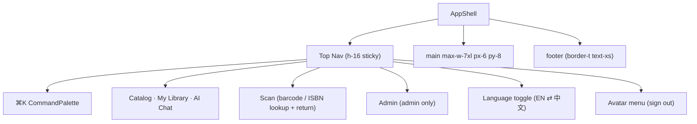
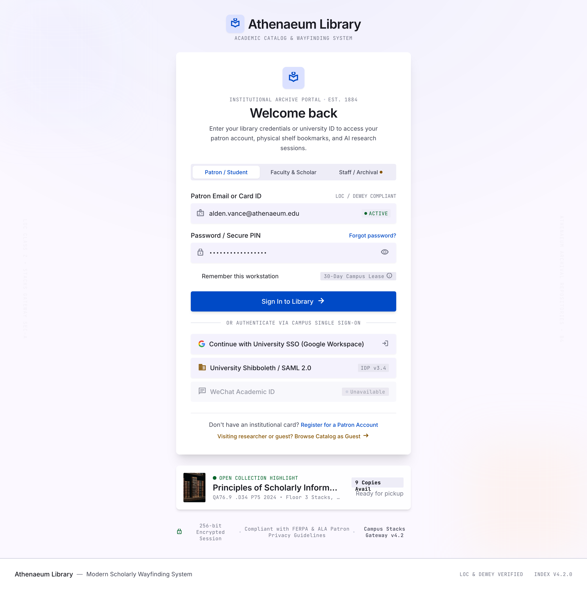
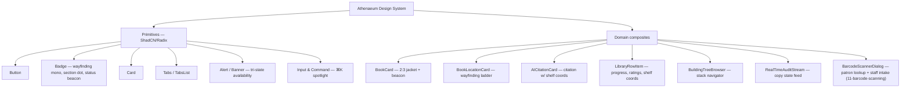
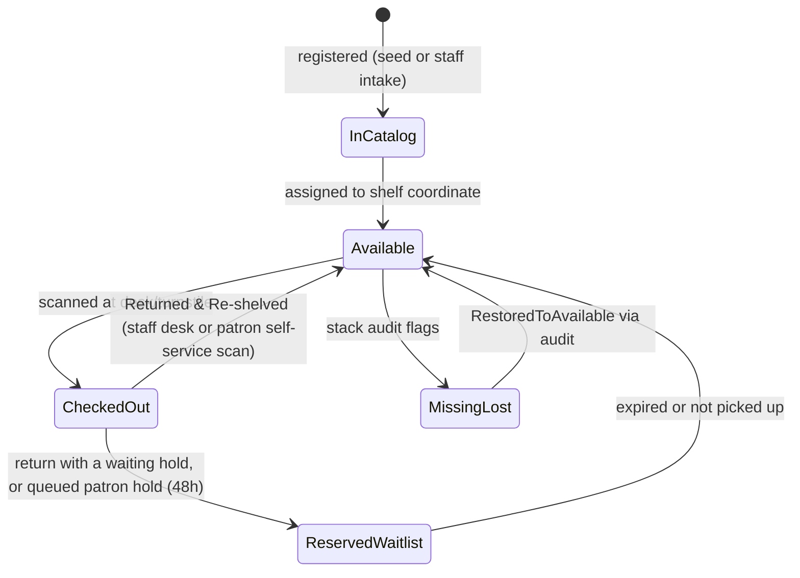

# UI Design System & Stitch Screen Gallery

> The complete Athenaeum design system ("Modern Scholarly Wayfinding") plus the Stitch screen gallery: visual language, tokens, typography, app shell, screen-by-screen specs, component hierarchy, copy state machine, ShadCN mapping, and accessibility requirements — visual source of truth is Stitch (project `projects/4345961817697568978`); component/page wiring in [07-frontend.md](./07-frontend.md).

## Contents

1. [Visual Language](#1-visual-language)
2. [Wayfinding Section Colors](#2-wayfinding-section-colors)
3. [Design Tokens](#3-design-tokens)
4. [Typography](#4-typography)
5. [Elevation & Radius](#5-elevation--radius)
6. [App Shell & Navigation](#6-app-shell--navigation)
7. [Stitch Screen Gallery](#7-stitch-screen-gallery)
8. [Screen-by-screen Specs (6 screens)](#8-screen-by-screen-specs)
9. [Component Hierarchy](#9-component-hierarchy)
10. [Copy State Machine](#10-copy-state-machine)
11. [ShadCN Mapping](#11-shadcn-mapping)
12. [Accessibility Requirements](#12-accessibility-requirements)
13. [Deferred UI Items](#13-deferred-ui-items)

## 1. Visual Language

Persona: **Modern Scholarly Wayfinding** — calm minimalist, precision-first. Four
principles (from DESIGN.md §1, canonical):

1. **Bibliographic Precision & Physical Reality** — digital records never hide physical reality: every volume displays shelf/aisle/floor coordinates beside ISBN, LOC, Dewey metadata.
2. **Calm Academic Clarity** — high-contrast neutral canvas (`#fbf8ff` backdrop, pure-`#ffffff` cards) with Academic Cobalt (`#2563eb`) + Warm Amber (`#f59e0b`) accents only.
3. **Intentional Dual Typography** — `Inter` for UI, `JetBrains Mono` for call numbers, barcodes, shelf coordinates, machine telemetry.
4. **Instant Ambient Telemetry** — emerald/orange/rose status colors make availability glanceable before click or walk.

## 2. Wayfinding Section Colors

Canonical section palette (rows stored in `sections.color` — [05 §2](05-building-layout.md#2-section-categories)):

| Section | Hex |
| --- | --- |
| Science Fiction & Speculative | `#3B82F6` |
| Science, Mathematics & Tech | `#10B981` |
| History, Humanities & Arts | `#8B5CF6` |
| Reference & Special Folios | `#6B7280` |
| Periodicals & Archives | `#F59E0B` |

Usage: hairline left-edge tags, section filter dots, and call-number badges only —
never broad fills (avoid color noise in dense lists).

## 3. Design Tokens

| Token | Hex | HSL / Tailwind | Usage |
| --- | --- | --- | --- |
| `--background` | `#fbf8ff` | `260 60% 99%` | app backdrop |
| `--foreground` | `#18181b` | `240 10% 3.9%` (Zinc-900) | body text |
| `--card` | `#ffffff` | `0 0% 100%` | card surfaces, modals, popovers |
| `--card-foreground` | `#18181b` | `240 10% 3.9%` | card headings |
| `--primary` | `#2563eb` | `221.2 83.2% 53.3%` (Blue-600) | CTAs, active tabs, nav |
| `--primary-foreground` | `#f8fafc` | `210 40% 98%` | text on primary |
| `--secondary` | `#f4f4f5` | `240 4.8% 95.9%` (Zinc-100) | filter badges, hover fills |
| `--muted` | `#f4f4f5` | `240 4.8% 95.9%` | inactive backgrounds |
| `--muted-foreground` | `#71717a` | `240 3.8% 46.1%` (Zinc-500) | metadata, captions |
| `--accent` | `#f59e0b` | `37.7 92.1% 50.2%` (Amber-500) | AI badges, bookmarks, wayfinding accents |
| `--success` | `#16a34a` | `142.1 76.2% 36.3%` (Green-600) | available states |
| `--warning` | `#ea580c` | `24.6 95% 53.1%` (Orange-600) | waitlist, holds, due soon |
| `--destructive` | `#dc2626` | `0 84.2% 60.2%` (Red-600) | lost, restricted, errors |
| `--border` | `#e4e4e7` | `240 5.9% 90%` (Zinc-200) | card/table borders |
| `--ring` | `#2563eb` | `221.2 83.2% 53.3%` | focus rings |

Status chip recipes: Available `#DCFCE7` bg / `#15803D` text / dot `#16A34A` ·
Checked Out `#FFEDD5` / `#C2410C` / `#EA580C` · Not Available `#FEE2E2` / `#B91C1C` / `#DC2626`.

## 4. Typography

```css
--font-sans: 'Inter', system-ui, -apple-system, sans-serif;
--font-mono: 'JetBrains Mono', ui-monospace, SFMono-Regular, Menlo, monospace;
```

| Level | Recipe |
| --- | --- |
| Display title | `text-3xl font-bold tracking-tight` |
| Section heading | `text-2xl font-semibold tracking-tight` |
| Card title | `text-lg font-semibold` |
| Body | `text-sm font-normal leading-relaxed text-foreground` |
| Metadata/labels | `text-xs font-medium text-muted-foreground` |
| Call numbers, shelf IDs, barcodes | `font-mono text-xs uppercase tracking-wider` (tabular figures) |

## 5. Elevation & Radius

| Surface | Recipe |
| --- | --- |
| Cards | `rounded-lg shadow-sm border border-border` |
| Card hover | `hover:shadow-md hover:border-primary/40 transition-all duration-150` |
| Badges/chips | `rounded-full` |
| Inputs/buttons | `rounded-md` |
| Modals/floating overlays | `shadow-2xl border border-border` |
| Book covers | strict 2:3 aspect, 4px corner radius, 1px inset alpha border |

## 6. App Shell & Navigation

```
┌────────────────────────────────────────────────────────────┐
│ Top Nav (h-16, sticky, backdrop-blur-md)                   │
│ [ Crest + Athenaeum ] [ ⌘K Search ] [ Scan ] [ Nav ] [ Admin | 👤 ] │
├────────────────────────────────────────────────────────────┤
│ Page Content (max-w-7xl mx-auto px-6 py-8)                 │
├────────────────────────────────────────────────────────────┤
│ Footer (border-t, text-xs)                                 │
└────────────────────────────────────────────────────────────┘
```

- Authenticated shell: nav bar w/ ⌘K, Catalog, My Library, AI Librarian, Scan
  (barcode/ISBN — all users), Staff Admin (role-gated), alerts, avatar. Unauthenticated `/login`: bare canvas, no
  shell ([04 §1](04-auth.md#1-login-screen-stitch)).



### Localization & Voice (additions)

Additive controls not present in the original Stitch exports — specs are owned by
[14-localization.md](./14-localization.md) and [15-voice-input.md](./15-voice-input.md):

- **Language toggle** (`EN` ⇄ `中文`, [14 §9](./14-localization.md#9-language-toggle)): in
  the top nav next to the Avatar menu, and on the bare `/login` canvas. Text toggle with
  `aria-label` + `aria-pressed`, keyboard-operable.
- **Voice mic** ([15 §2](./15-voice-input.md#2-ux--push-to-talk)): a mic toggle in the
  chat composer beside Send; a recording indicator while capturing; hidden when
  `MediaRecorder` is unavailable.
- **CJK typography**: the `Inter` stack gains a **Noto Sans SC** fallback
  ([14 §8](./14-localization.md#8-typography--fonts)); `JetBrains Mono` covers no CJK and
  stays reserved for machine strings.
- **Language** enum labels (availability, copy status, reading stage) render localized
  via display-label maps ([14 §6](./14-localization.md#6-enum-display-label-maps)).

> ⚠️ TODO: regenerate the AI Librarian screen and app shell in Stitch to include the mic
> and language toggle (Stitch is the visual source of truth), then re-export
> (runbook: [§7.1.1](#711-stitch-mcp-tool-verification--export-runbook)).

## 7. Stitch Screen Gallery

Stitch project **"Athenaeum: Smart Library System"** —
`projects/4345961817697568978` (device DESKTOP; LIGHT theme, Inter + JetBrains
Mono, ROUND_FOUR, primary seed `#2563eb` — matches the token table above).
Manifest with all signed URLs: `.artifacts/stitch/stitch-manifest.json`.

### 7.1 Gallery

| # | Stitch title | Screen ID | Route | Dimensions | Screenshot (local export) | HTML (local export) |
| --- | --- | --- | --- | --- | --- | --- |
| 1 | Sign In - Athenaeum Library | `b6e00ec93bff4f7dbabfeefcaad1166e` | `/login` | 2560×2536 |  | [sign_in/code.html](../.artifacts/stitch/sign_in_athenaeum_library/code.html) |
| 2 | Catalog Browser - Athenaeum Library | `e9f24637e3da43c68aa771390938f8c4` | `/catalog` | 2560×3068 | — ([FIFE](#711-stitch-mcp-tool-verification--export-runbook)) | [catalog_browser/code.html](../.artifacts/stitch/catalog_browser_athenaeum_library/code.html) |
| 3 | Book Detail: Dune - Athenaeum Library | `723960ca2605417eb085f6e17a579bd2` | `/books/[id]` | 2560×4884 | — (FIFE) | [book_detail/code.html](../.artifacts/stitch/book_detail_dune_athenaeum_library/code.html) |
| 4 | My Library - Athenaeum Library | `9cee348492a04f3a98ab9ddb2c791258` | `/library` | 2560×3358 | — (FIFE) | [my_library/code.html](../.artifacts/stitch/my_library_athenaeum_library/code.html) |
| 5 | AI Librarian - Athenaeum Library | `70530f16d81642aa8d5784fe09076e11` | `/chat` | 2560×2186 | — (FIFE) | [ai_librarian/code.html](../.artifacts/stitch/ai_librarian_athenaeum_library/code.html) |
| 6 | Admin Portal - Athenaeum Library | `3177da5282a94617b61e9333d4446237` | `/admin`, `/admin/layout` | 2560×4182 | — ([not exported](#711-stitch-mcp-tool-verification--export-runbook)) | — |
| 7 | Athenaeum Library Catalog & Wayfinding System (early draft variant) | `77ccd1faf39d423cbbae00544f8f04b9` | — (superseded by #2) | 1280×1024 | — (not exported) | — |

Document artifacts on the canvas (not app screens): **DESIGN.md mirror exported locally**
→ [../.artifacts/stitch/modern_scholarly_wayfinding/DESIGN.md](../.artifacts/stitch/modern_scholarly_wayfinding/DESIGN.md);
"Book Library UI Specification" (`bcca77dc…`) and PRD (`f1b260d6…`) remain
manifest-only rows in `.artifacts/stitch/stitch-manifest.json`.

The **Universal Barcode & ISBN Scanner** dialog is a newer artifact (not one of the six app
screens; it is a modal on any route): local export
[../.artifacts/stitch/barscanner_ISBN/code.html](../.artifacts/stitch/barscanner_ISBN/code.html) —
the visual reference for Patron Lookup + Staff Intake ([11](./11-barcode-scanning.md#7-uiux-specification),
wiring [07 §Scanner dialog](07-frontend.md#scanner-dialog--patron-lookup--staff-intake)). It is a
behavioural addition, not a Stitch screen ID; the RFID/label/MARC affordances it sketches stay
deferred ([§13](#13-deferred-ui-items)).

> ⚠️ TODO: Admin Portal + draft variant exports; `screen.png` re-export for the
> four FIFE failures (rows 2–5). HTML is complete for rows 1–5 — export verified:
> Sign In (WeChat disabled ✓ · role tabs ✓ · SAML row commented ✓ · "EST. 1884" ✓),
> Catalog (Keyword/Semantic/Hybrid + ⌘K + "In Building" facet ✓), Book Detail
> (ATH-002941-C01..C3, Floor 3 → Aisle A-1, "Row 4, Eye Level" ✓), My Library
> (In Collection / Currently Reading / Completed / Bookmarks / Want to Read ✓),
> AI Librarian ("RAG Engine v2 • Claude 3.5 Sonnet", "/ 5" quota ✓)

### 7.1.1 Stitch MCP tool verification & export runbook

Tool inventory as mounted when the docs were generated (verified via live calls):

| MCP tool | Available | Verified behavior |
| --- | --- | --- |
| `list_projects` | ✅ | returned project + full DESIGN.md theme export |
| `list_screens` | ✅ | 10 entries, each with `screenshot.downloadUrl` + `htmlCode.downloadUrl` (session-signed) |
| `get_screen` | ✅ | per-screen metadata only — same signed URLs, no inline image/HTML |
| `generate_screen_from_text` | ✅ (unused) | generation — out of scope here |
| `upload_design_md` | ✅ (unused) | — |
| `get_screen_code` | ❌ not mounted | virtual tool of the [stitch-mcp proxy](https://github.com/davideast/stitch-mcp) — returns HTML inline |
| `get_screen_image` | ❌ not mounted | same proxy — returns the screenshot as base64 |
| `build_site` / `get_project` / `create_design_system_from_design_md` | ❌ not mounted | — |

Why direct download fails (attempted twice, with fresh signed URLs):

```bash
curl -sSL 'https://lh3.googleusercontent.com/aida/<ME>' -o out.png
# → 302 lh3.google.com/rd-aida/<token> → 302 accounts.google.com/v3/signin
# result: HTML sign-in page (~1.2MB), for EVERY signed URL; webfetch identical
```

The URLs are session-signed for the owner's Google account (project visibility:
`PRIVATE`); the MCP server holds the session but this mount exposes no
download/content tool. The upstream fix is the stitch-mcp proxy above
(`get_screen_image` → base64, `get_screen_code` → HTML) or its CLI
(`npx @_davideast/stitch-mcp snapshot` / `serve -p 4345961817697568978`) after
`init` or with `STITCH_API_KEY`.

**Current export state** (owner-exported, see manifest `local_artifacts`):

| Artifact | State |
| --- | --- |
| `sign_in_athenaeum_library/{screen.png, code.html}` | ✅ PNG (2560×2574) + HTML |
| `catalog_browser_…`, `book_detail_dune_…`, `my_library_…`, `ai_librarian_…` `/code.html` | ✅ HTML only — PNG failed (`<FIFE Image failed to fetch>`): re-export while logged in |
| `modern_scholarly_wayfinding/DESIGN.md` | ✅ design-system mirror |
| Admin Portal (`3177da52…`), draft variant (`77cc…`) | ❌ not exported yet |

Runbook for the remaining five exports: open each `screenshot_url` /
`html_url` from `.artifacts/stitch/stitch-manifest.json` in a logged-in browser,
save into the matching `.artifacts/stitch/<folder>/` path above, then the gallery
embeds resolve and the TODO on rows 2–7 closes.

### 7.2 Screen → Doc Cross-reference

| Stitch screen (ID short) | 07-frontend | Other docs |
| --- | --- | --- |
| Sign In `b6e0…` | [07 §/login](./07-frontend.md#7-page-breakdowns) | [04 §1](04-auth.md#1-login-screen-stitch), [03 §4](03-api-spec.md#4-auth-endpoints) |
| Catalog Browser `e9f2…` | [07 §/catalog](./07-frontend.md#7-page-breakdowns) | [03 §5.1](03-api-spec.md#51-get-apibookssearch) |
| Book Detail: Dune `7239…` | [07 §/books/{id}](07-frontend.md#7-page-breakdowns) | [05 §5](05-building-layout.md#5-book-detail-screen-stitch), [02 §6](02-data-model.md#6-book_locations-view) |
| My Library `9cee…` | [07 §/library](./07-frontend.md#7-page-breakdowns) | [03 §6](03-api-spec.md#6-personal-library--waitlist) |
| AI Librarian `7053…` | [07 §/chat](./07-frontend.md#7-page-breakdowns) | [06 §9](06-ai-rag.md#9-chat-screen-stitch), [03 §7](03-api-spec.md#7-chat-sse) |
| Admin Portal `3177…` | [07 §/admin,/admin/layout](07-frontend.md#7-page-breakdowns) | [03 §8](03-api-spec.md#8-admin), [05 §6](05-building-layout.md#6-mock-data--seeding) |
| Draft variant `77cc…` | provenance only | [12 §13](#13-deferred-ui-items) |

## 8. Screen-by-screen Specs

All six canonical screens exist in Stitch. Stitch renders ~2560px-wide desktop
mockups — treat as 1440px-design-width references (1320px content in
`max-w-7xl`).

### Screen 1 — `/login` Institution Gateway
Stitch: **Sign In** (`b6e0…`, exported: [04 §1](04-auth.md#1-login-screen-stitch)).
Spec (implemented in [07](07-frontend.md#login--screen-1-stitch-b6e00ec9)):
centered card, no shell; crest masthead + `EST. 1884` badge; role switcher tabs
**Patron / Student · Faculty & Scholar · Staff** (export-verified;
purely presentational); email-or-barcode identifier with validation beacon;
password field; **Google SSO button (works)**; **WeChat Academic ID button
(disabled, labeled "Unavailable" — export-verified)**; the DESIGN.md
Shibboleth/SAML row survives only as an HTML comment in the export — do not
render it ([04 §3](04-auth.md#3-google-sso)); open-collection spotlight preview
card. Flows: [04 §2-3](04-auth.md#2-emailpassword-flow).

### Screen 2 — `/catalog` Catalog Browser & Hybrid Search
Stitch: **Catalog Browser** (`e9f2…`, HTML exported). Tri-modal search switcher
(Keyword/Semantic/Hybrid — export-verified; params [03 §5.1](03-api-spec.md#51-get-apibookssearch));
faceted wayfinding sidebar (section checkboxes w/ color dots, availability facet
worded "In Building" per export, era sliders); 2:3 book-card grid with top-right
availability beacons; call-number mono badges; ⌘K palette (export-verified).
Empty/edge states: [07 §9](07-frontend.md#9-loading-empty--error-states).

### Screen 3 — `/books/[id]` Book Detail & Spatial Wayfinding
Stitch: **Book Detail: Dune** (`7239…`). 40/60 two-column (jacket, CTA, Dewey/LOC/
ISBN metadata · tri-state banner, ladder, manifest); turn-by-turn ladder (localized in zh-CN — [14 §6.1](14-localization.md#61-wayfinding-vocabulary)) from
`book_locations` ([05 §3-4](05-building-layout.md#3-location-path-tokens)); copy
manifest table of `book_copies` rows; archival affinity carousel (`neighbors` —
[03 §5.2](03-api-spec.md#52-get-apibooksid)).

### Screen 4 — `/library` Personal Library & Patron Dashboard
Stitch: **My Library** (`9cee…`). KPI bar (In Collection 24 / Currently Reading 2 /
Completed 15 / Bookmarks & AI 7 — seeded to match, [13 §demo users](13-mock-data-reference.md#6-demo-users--personal-library));
reading-stage tabs; `LibraryRowItem` rows with shelf coordinates + progress +
inline ratings; holds & waitlists tab ([03 §6.3](03-api-spec.md#63-waitlist)); AI
cross-reference banner deep-linking `/chat`.

### Screen 5 — `/chat` AI Librarian Research Assistant
Stitch: **AI Librarian** (`7053…`). Two-pane (session drawer + stream), message
bubbles, `AICitationCard`s with shelf coordinates + deep links; telemetry meta
bar (model engine label + latency); rate-limit quota meters (5/min · 50/day —
[03 §2](03-api-spec.md#2-rate-limiting)). SSE contract: [06 §6](06-ai-rag.md#6-sse-event-contract).

### Screen 6 — `/admin` and `/admin/layout` Staff Admin & Stacks Manager
Stitch: **Admin Portal** (`3177…`, single screen; **not exported yet** — export
pending [7.1.1](#711-stitch-mcp-tool-verification--export-runbook)). Executive KPI grid (titles,
inventory occupancy, active patrons, AI accuracy); `BuildingTreeBrowser` drill-down
(Building → Floors → Sections → Aisles → Shelves); `Shelf Manifest Inspector` right
panel (slot occupancy meter, quick-assign barcode input → copy state changes);
floor mini-map (SVG); `RealTimeAuditStream` (`copy_events` poll — [03 §8.1](03-api-spec.md#81-admin-kpis--audit)).
Two routes share components — split decision: [07 §7](07-frontend.md#7-page-breakdowns).
Figure captions like "4,821 titles" are Stitch placeholder numbers; real seed
values are 40 titles / 60 copies ([13](13-mock-data-reference.md)), not a defect.

## 9. Component Hierarchy



## 10. Copy State Machine

Barcode format: `ATH-XXXXXX-CY` (`C1` = copy 1 — allocation: [08 §5](08-seed-data.md#5-barcode-allocation)).
DB statuses: [02 §book_copies](02-data-model.md#book_copies).



| Transition | Trigger | Source field |
| --- | --- | --- |
| `InCatalog → Available` | admin assigns shelf | `POST /api/admin/copies`, [03 §8.3](03-api-spec.md#83-admin-copies) |
| `Available → CheckedOut` | staff scan at desk | `PATCH /api/admin/copies/{id}` |
| `CheckedOut → Available` ("Returned & Re-shelved") | staff desk return **or patron self-service return** | staff: `PATCH /api/admin/copies/{id}`; patron: `POST /api/copies/{id}/return` (`copy_events.source='self_return'` — [03 §6.4](03-api-spec.md#64-post-apicopiesidreturn)) |
| `CheckedOut → ReservedWaitlist` | waitlist turnover (48 h) on return | `PATCH` **or** `POST /api/copies/{id}/return` + `waitlist.ready_at` set — [03 §6.3](03-api-spec.md#63-waitlist) |
| `MissingLost → Available` ("RestoredToAvailable") | audit restores | PATCH |

Every transition appends a `copy_events` row (`from_status`, `to_status`,
`actor`, `source`) — [02 §copy_events](02-data-model.md#copy_events).

## 11. ShadCN Mapping

| Athenaeum component | Composed of ShadCN primitives |
| --- | --- |
| `BookCard` | `Card` + cover frame + `Badge` (beacon) + mono call-number `Badge` |
| `BookLocationCard` | `Card` + `Badge` (section color) + mono ladder + `Button` (Ask AI) |
| `AICitationCard` | horizontal `Card` + thumbnail + `Badge` + deep-link `Button` |
| `LibraryRowItem` | `Table` row / `Card` + `Slider`-less progress + star `Rating` |
| `BuildingTreeBrowser` | nested `Collapsible`/`Tree` list + `Badge` occupancy |
| `RealTimeAuditStream` | `Table` + `Badge` + Toaster hooks |
| `BarcodeScannerDialog` | `Dialog` + `Tabs` + `<video/>` + overlay frames — [11](11-barcode-scanning.md) |
| Availability banner | `Alert` variants (`success`/`warning`/`destructive`) |

## 12. Accessibility Requirements

- **Keyboard**: ⌘K palette, tab order in reading order, Esc closes dialogs (Radix default), focus rings = `--ring` (2px).
- **ARIA/semantics**: `aria-live="polite"` on toasts, `aria-label` on all icon-only buttons (torch, camera flip, avatar), `aria-current` on active nav; icon-only scanner controls labeled; screen-reader text for availability beacons ("3 of 3 copies available").
- **Focus trap** in dialogs/`Sheet` (Radix), visible grab targets ≥ 44 px on touch.
- **Contrast** — plan to verify pairs: success/destructive text tokens vs their light fills; interactive text on `--background` ≥ 4.5:1; mono badges on zinc surfaces ≥ 4.5:1.
- **Motion** — respect `prefers-reduced-motion` (drop hover-lift transitions).
- **Images** — alt text on covers = `"<title> — <first author>, jacket"`.
- Semantics: `nav` + landmarks, one `h1` per page, `aria-live` beacon chips, `aria-label` on icon-only.

> ⚠️ TODO: run axe-core audit at v1; contrast numbers above are targets, not verified measurements.

## 13. Deferred UI Items

| Item | Marker |
| --- | --- |
| RFID hardware UI (gates/robots) & live audit hardware streams | mimic in the audit stream only; hardware out of scope — [10](10-roadmap.md) |
| Scanner Staff-Intake extras: RFID encode, thermal label print, Edit MARC | deferred — the scanner artifact sketches them but v1 renders ISBN intake + copy-tag assignment only ([11 §11](11-barcode-scanning.md#11-scope-impact)) |
| Shibboleth/SAML row on login screen | disabled placeholder only ([04](04-auth.md#3-google-sso)) |
| Rate-limit analytics dashboard | quota meters only — [03 §2](03-api-spec.md#2-rate-limiting) |
| Draft Stitch variant screen `77cc…` | kept for provenance; do not implement |
