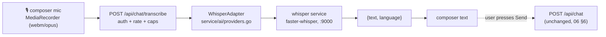

# Voice Input (Push-to-Talk)

> The voice-input contract for `/chat`: browser audio capture, the `POST /api/chat/transcribe` endpoint, the self-hosted Whisper service behind a Go ACL adapter, model/env configuration, limits, error codes, and privacy — chat streaming in [06-ai-rag.md](./06-ai-rag.md#6-sse-event-contract), the composer in [07-frontend.md](./07-frontend.md), endpoint envelope rules in [03-api-spec.md](./03-api-spec.md), localization linkage in [14-localization.md](./14-localization.md#10-ai-reply-language).

## Contents

1. [Scope](#1-scope)
2. [UX — Push-to-Talk](#2-ux--push-to-talk)
   - [2a. Live (interim) transcript](#2a-live-interim-transcript)
3. [Architecture](#3-architecture)
4. [Transcription Endpoint](#4-transcription-endpoint)
5. [Whisper Service](#5-whisper-service)
6. [Limits, Rate & Errors](#6-limits-rate--errors)
7. [Privacy](#7-privacy)
8. [Frontend Wiring](#8-frontend-wiring)
9. [Testing](#9-testing)
10. [Traceability](#10-traceability)

## 1. Scope

| In scope | Out of scope |
| --- | --- |
| Voice input on `/chat` only | Voice input on any other screen (catalog, command palette, …) |
| Speech → editable transcript in the composer | Text-to-speech / spoken AI answers |
| Self-hosted Whisper transcription | Cloud STT providers |
| Desktop browsers with `MediaRecorder` + `getUserMedia` | Always-on / wake-word listening |

> ⚠️ TODO: cloud/true-streaming STT (WebSocket/token streaming) and voice input on other
> screens are deferred — live text is approximated by chunked re-transcription (§2a); revisit in
> [10 §5](./10-roadmap.md#5-future-enhancements).

## 2. UX — Push-to-Talk

- The composer ([12 §8 chat screen](./12-ui-design.md#8-screen-by-screen-specs)) gains a
  **mic toggle** next to Send.
- Click to start recording, click to stop (with a visible recording indicator); a clip
  is then POSTed to `/api/chat/transcribe`.
- The returned transcript is **inserted into the composer** beside any typed text — the
  user reviews/edits and presses **Send**. Voice never auto-submits, so library names and
  ISBNs can be corrected and the normal send/rate-limit path is reused.
- Send is disabled while recording or transcribing; the mic is hidden when the browser
  lacks `MediaRecorder`/`getUserMedia`.

### 2a. Live (interim) transcript

While recording, the composer shows an **interim transcript** that refreshes as the user
speaks (chunked re-transcription — no streaming protocol):

- `MediaRecorder` runs with a 1 s timeslice. Every **~2 s**, if no partial request is in
  flight, the client uploads the **cumulative** clip so far (all chunks since start —
  later chunks are not independently decodable) to `POST /api/chat/transcribe?partial=true`.
- Each partial carries a sequence number; responses older than the newest applied one, or
  arriving after stop/cancel, are **ignored** (no out-of-order flicker).
- The interim text renders as **ghost text inside the composer textarea**, muted and
  appended after the typed draft (one space separator, as in §2's merge rule). An
  `aria-hidden`, `pointer-events-none` mirror layer (`data-testid="chat-composer-ghost"`)
  sits exactly over the textarea with identical font, padding, wrapping and scrollbar gutter;
  it renders the draft invisibly followed by the muted interim span
  (`data-testid="chat-voice-interim"`). The textarea auto-grows to fit draft + ghost (up to
  its max height) and the layer's scroll follows the textarea's. The placeholder is hidden
  while ghost text shows.
- The interim text is **never written into the draft** — the textarea value only ever holds
  typed text, so the user can keep typing while speaking. Screen readers get the interim text
  from a separate sr-only `aria-live="polite"` region (`data-testid="chat-voice-interim-live"`).
- On stop, polling ends and the normal **final pass** (no `partial`, `WHISPER_MODEL`)
  runs; its transcript replaces the interim text and is merged into the composer (§2).
  Cancel (Esc, on the mic button or in the composer) or leaving the page stops polling and
  discards the ghost text.
- Partial failures (`429`, `503`, `400`, network) are **silent**: recording continues, the
  last interim text stays, and no toast/note is shown. The 60 s cap (§6) still stops the
  recording.

## 3. Architecture



Audio flows through the API to the model and is **discarded**; the transcript is the only
artifact (and it enters the normal chat path, where the [14](./14-localization.md) locale
already applies).

## 4. Transcription Endpoint

`POST /api/chat/transcribe[?partial=true]` — multipart `audio` upload (🔒, mirroring chat auth in
[03 §7](./03-api-spec.md#7-chat-sse)).

```json
{ "text": "where can I find books on Babylonian mathematics", "language": "en" }
```

| Field | Type | Notes |
| --- | --- | --- |
| `audio` (form) | file | `webm`/`opus` from `MediaRecorder`; any container ffmpeg can decode |
| `locale` (form, optional) | string | `en` \| `zh-CN`; maps to the Whisper `language` hint (`en`/`zh`); omitted → auto-detect |
| `partial` (query, optional) | bool | `true` → live interim pass (§2a): fast model (`WHISPER_PARTIAL_BASE_URL`), 15 s timeout, partial rate bucket + one-in-flight guard (§6); default `false`. A query parameter so the limiter can route before the body is read; non-boolean → 400 |
| `text` (response) | string | transcript; may be `""` for silent/unintelligible clips |
| `language` (response) | string | detected/used language |

Lifecycle: auth → **rate check (§6)** (partials: partial bucket → in-flight guard) → size/duration validation → `WhisperAdapter` call
(30 s timeout; 15 s for partials) → return `{text, language}`. Audio is never persisted or logged
([06 §8](./06-ai-rag.md#8-guardrails)); the transcript is **not** a chat turn until the
user sends it.

## 5. Whisper Service

| Concern | Value |
| --- | --- |
| Image | `onerahmet/openai-whisper-asr-webservice:v1.10.0` with `ASR_ENGINE=faster_whisper` (model loaded on start) |
| Model | `WHISPER_MODEL` = `small` (multilingual, CPU-acceptable); compose passes it to the container as `ASR_MODEL` |
| Port / URL | `:9000`; `WHISPER_BASE_URL` (e.g. `http://localhost:9000`) |
| Compose | always-on service beside `postgres`/`redis`/`ollama` ([09 §2](./09-development.md#2-docker-compose), [01 §6](./01-architecture.md#6-docker-compose-topology)) |
| Volume | `whisperdata` (model cache, `ASR_MODEL_PATH=/data/whisper`) |
| Model pull | one-time step in the [09 §2](./09-development.md#2-docker-compose) startup block, mirroring the Ollama pull |
| Adapter | `WhisperAdapter` in `api/internal/service/ai/providers.go` — the ACL pattern of [06 §5](./06-ai-rag.md#5-provider-configuration-acl); swapping STT vendors touches one file |
| Partials (§2a) | second compose service `whisper-fast` — same pinned image, `ASR_MODEL=${WHISPER_FAST_MODEL:-base}`, host port `:9001` (container `:9000`), volume `whisperfastdata` (`ASR_MODEL_PATH=/data/whisper-fast`), same healthcheck. The API's second `WhisperAdapter` targets `WHISPER_PARTIAL_BASE_URL` (empty → falls back to `WHISPER_BASE_URL`); final passes always use `WHISPER_MODEL` (`small`) |

Env vars (`WHISPER_BASE_URL`, `WHISPER_MODEL`, `WHISPER_PARTIAL_BASE_URL`, `WHISPER_FAST_MODEL`) are added to the [01 §7](./01-architecture.md#7-environment-variables)
table and `.env.example`.

Upstream wire contract (what `WhisperAdapter` sends and the `api/cmd/e2e-stubs` fake mirrors):

```text
POST {WHISPER_BASE_URL}/asr?task=transcribe&output=json&encode=true&vad_filter=true[&language=en|zh]
Content-Type: multipart/form-data      part "audio_file" = the clip (ffmpeg-decoded by the service)

200 (served as text/plain; body is JSON)
{"language":"en","text":" Where can I find books on Babylonian mathematics?",
 "segments":[{"id":1,"seek":0,"start":0.0,"end":3.0,"text":" …", …}]}
```

The adapter trims `text`, keeps `language` (the hint when given, otherwise the detected
code), and derives the clip length from the last segment `end` for the §6 duration backstop.
`vad_filter=true` drops silence so silent clips return `""` instead of hallucinated text.
Upstream statuses: `422` (missing part) and `500` (ffmpeg could not decode the clip) →
`VALIDATION_FAILED`; connection errors, timeouts and other `5xx` → `TRANSCRIPTION_UNAVAILABLE`.

## 6. Limits, Rate & Errors

| Rule | Value |
| --- | --- |
| Max clip length | 60 s (client-enforced; server backstop: transcribed length > 62 s → 400) |
| Max upload size | ~10 MB (10 MiB `audio` part; the multipart body is read in memory, never spilled to temp files) |
| Upstream timeout | 30 s (partials: 15 s — a later partial is stale anyway) |
| Rate limit | **dedicated 10/min per `user_id`** bucket (transcription is CPU-expensive; does not share the chat 5/min bucket) |
| Partial rate limit | `?partial=true` skips the 10/min bucket and uses its own **60/min per `user_id`** bucket (2 s cadence ≈ 30/min per recording) |
| Partial concurrency | **one in-flight partial per user** (Redis `SET NX` lock, released when the request ends, 20 s TTL backstop); a concurrent second partial → 429 `RATE_LIMITED` with `Retry-After: 1`. Final calls are never blocked by an in-flight partial |
| Partial caps | same 60 s / 10 MiB caps and duration backstop as final calls |
| Auth | required (🔒) |

| Error | HTTP | When |
| --- | --- | --- |
| `VALIDATION_FAILED` | 400 | missing/undecodable audio, over caps |
| `RATE_LIMITED` | 429 | over the 10/min bucket; partials: over the 60/min bucket or another partial in flight |
| `TRANSCRIPTION_UNAVAILABLE` | 503 | Whisper service down or upstream timeout (mirrors `EMBEDDING_UNAVAILABLE` precedent) |
| — | 200 | silent/unintelligible clip → `{"text":"","language":…}` |

## 7. Privacy

- Raw audio — final clips and every cumulative partial upload — is never stored, cached, or
  written to `messages`; interim text is client-side only. Only the final transcript enters
  the chat flow **after the user sends it**.
- Logging follows [09 §7](./09-development.md#7-logging): request id + durations, never
  audio bytes or transcript bodies.
- The mic only records on explicit push-to-talk; no ambient capture.

## 8. Frontend Wiring

| File | Role |
| --- | --- |
| `web/hooks/use-voice-input.ts` | `MediaRecorder` capture, permission handling, record/stop state, POST to `/api/chat/transcribe`, transcript insertion, live partial polling (`interim` text, §2a) |
| `web/lib/voice.ts` | pure helpers incl. `PartialScheduler` (2 s cadence, single in-flight, stale-response guard) |
| `web/components/**` chat composer | mic toggle, recording indicator, Send gating, "didn't catch that" on empty text, error toast on 503/429 |
| `web/lib/api-client.ts` | typed `transcribe(audio, locale, fileName, { partial })` mirroring the endpoint |

The active locale ([14 §10](./14-localization.md#10-ai-reply-language)) is passed as the
language hint so Chinese speech decodes faster and more accurately.

## 9. Testing

| Layer | Coverage |
| --- | --- |
| Handler unit | `httptest` against a fake `WhisperAdapter`: caps, rate bucket, timeout → 503, silent → 200, auth; partials: fast-model routing, 60/min bucket isolation, one-in-flight 429, flag validation |
| Web unit | Vitest on `PartialScheduler`: cadence, single in-flight, stale/out-of-order drop, stop/cancel, silent failures |
| Adapter unit | locale → `language` hint mapping; upstream error mapping |
| E2E | Playwright with `--use-fake-device-for-media-stream --use-fake-ui-for-media-stream`; the Whisper stub returns fixed text that lands in the composer; the `/fast/asr` stub returns a growing strict prefix so the spec asserts interim text appears before the final transcript ([09 §8](./09-development.md#8-testing-strategy), [06 §6](./06-ai-rag.md#6-sse-event-contract)) |
| Manual | mic-permission-denied path; Whisper-down 503 path; both en and zh-CN |

## 10. Traceability

| Concern | Owner |
| --- | --- |
| SSE / chat turn | [06-ai-rag.md](./06-ai-rag.md) |
| Endpoint envelope + error catalog | [03-api-spec.md](./03-api-spec.md#9-error-catalog) |
| Compose / env / dev loop | [01-architecture.md](./01-architecture.md), [09-development.md](./09-development.md) |
| Composer UI | [12-ui-design.md](./12-ui-design.md), [07-frontend.md](./07-frontend.md) |
| Locale → language hint | [14-localization.md](./14-localization.md#10-ai-reply-language) |
| Scope / deferrals | [10-roadmap.md](./10-roadmap.md) |
