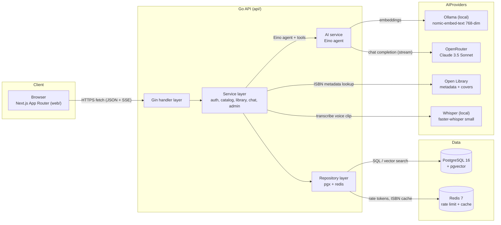

# Athenaeum Library — Documentation Index

> Reference-style implementation docs for the Athenaeum Library Management & Scholarly Wayfinding System: a Go + Gin API, PostgreSQL 16 + pgvector, Redis 7, Eino RAG chat, and a Next.js + ShadCN frontend, designed so an AI coding agent (or new developer) can build the entire project from these files alone.

## Contents

1. [Project Overview](#1-project-overview)
2. [Tech Stack](#2-tech-stack)
3. [Feature Scope](#3-feature-scope)
4. [Documentation Map](#4-documentation-map)
5. [Monorepo Layout](#5-monorepo-layout)
6. [System Overview](#6-system-overview)
7. [Quickstart](#7-quickstart)
8. [Stitch UI Source](#8-stitch-ui-source)
9. [Conventions](#9-conventions)

## 1. Project Overview

| Property | Value |
| --- | --- |
| Name | Athenaeum Library — Management & Scholarly Wayfinding System |
| Type | Demo / portfolio project (single developer, 3-week build) |
| Domain | One physical library building: discovery, physical wayfinding, personal reading list, barcode intake, AI librarian |
| Users | Two roles only: `user` and `admin` |
| UI design source | Google Stitch (screen gallery: [12-ui-design.md](./12-ui-design.md)) |

Core v1 capabilities: keyword / semantic / hybrid catalog search, book detail with
turn-by-turn shelf wayfinding, camera barcode scanning for both audiences (patrons: ISBN
lookup + self-service return; staff: book intake), personal
library (favorite / read / reading), availability + waitlist, streamed AI librarian
chat over RAG with tool use, and an admin stacks manager.

## 2. Tech Stack

Locked choices — do not substitute without updating this table and [01-architecture.md](./01-architecture.md).

| Layer | Choice |
| --- | --- |
| Backend | Golang + Gin |
| Architecture | Service–Repository pattern (Clean Architecture) |
| Database | PostgreSQL 16 + pgvector |
| Cache / Rate limiting | Redis 7 |
| AI framework | CloudWeGo Eino |
| Chat LLM | OpenRouter (via Eino ACL adapter) |
| Embeddings | Ollama `nomic-embed-text` (768 dim, local) |
| Frontend | Next.js App Router + ShadCN UI + Tailwind CSS |
| Icons | Lucide |
| Barcode detection | `barcode-detector` polyfill (ZXing-C++ WASM) |
| Auth | Email/password (argon2id) + Google SSO (WeChat disabled placeholder) |
| Sessions | httpOnly cookies, 15-min access + 7-day refresh |
| Streaming | SSE (`text/event-stream`) |
| Speech-to-text | faster-whisper `small` (local, via Go ACL adapter) |
| Localization | next-intl — `en` + `zh-CN` (server + client components) |
| E2E testing | Playwright (Chromium) |
| Commit tooling | Conventional Commits · commitlint · lefthook |
| CI | GitHub Actions (lint + vet + unit + Playwright E2E) |
| Logging | `log/slog` + `tint` (colorized dev, JSON prod) |
| Container | Docker Compose (Postgres, Redis, API, Web, Ollama, Whisper) |

## 3. Feature Scope

v1 scope boundary is owned by [10-roadmap.md](./10-roadmap.md). Summary:

- **In v1**: email/password + Google SSO · catalog (multi-modal search) · book detail with physical location · **barcode scanner** — patron ISBN lookup + self-service return (`POST /api/books/scan`, `POST /api/copies/{id}/return`) and staff intake (`POST /api/books/fetch-isbn`) ([11](./11-barcode-scanning.md)) · "not available" 409 + waitlist · personal library · AI chat (RAG, streaming, tool use, rate limits, persisted sessions) · **voice input on `/chat`** ([15](./15-voice-input.md)) · **EN/zh-CN localization** ([14](./14-localization.md)) · **git commit workflow** + **Playwright E2E / CI** ([09 §5/§8](./09-development.md#5-common-commands)) · admin UI (books, copies, layout, users) · mock seed + Open Library enrichment · `docker compose up` one-command startup.
- **Out of scope** (each with a `> ⚠️ TODO:` marker in the relevant doc): observability stack, production TLS/proxy/backups, RFID integration, overdue **fines** + loan reminders + multi-copy holds, multi-building, email notifications, password reset, WeChat SSO, rate-limit analytics, WebSockets, Shibboleth/SAML, roles beyond `user`/`admin`, shelf robots / live audit hardware, scanner RFID/label/MARC extras, Traditional Chinese, cloud/streaming STT, multilingual embeddings. (Self-service **borrowing/return + loans** and **rating averages** are now in scope — [10 §1](10-roadmap.md#1-in-scope-v1--checklist) items 16-18.)

## 4. Documentation Map

Each doc owns exactly one concern; cross-reference instead of duplicating.

| File | Owns | Key cross-links |
| --- | --- | --- |
| [01-architecture.md](./01-architecture.md) | Layers, request lifecycle, Docker topology, env vars | [02](./02-data-model.md), [03](./03-api-spec.md), [09](./09-development.md) |
| [02-data-model.md](./02-data-model.md) | All tables, indexes, `book_locations` view, SQL | [03](./03-api-spec.md), [05](./05-building-layout.md), [06](./06-ai-rag.md) |
| [03-api-spec.md](./03-api-spec.md) | Every endpoint, envelopes, pagination, SSE contract, rate limits | [04](./04-auth.md), [06](./06-ai-rag.md), [11](./11-barcode-scanning.md) |
| [04-auth.md](./04-auth.md) | Auth flows, tokens, cookies, middleware wiring | [03](./03-api-spec.md), [07](./07-frontend.md), [12](./12-ui-design.md) |
| [05-building-layout.md](./05-building-layout.md) | Building hierarchy semantics, wayfinding resolution | [02](./02-data-model.md), [08](./08-seed-data.md) |
| [06-ai-rag.md](./06-ai-rag.md) | RAG pipeline, Eino agent, tools, SSE events, guardrails | [02](./02-data-model.md), [03](./03-api-spec.md), [07](./07-frontend.md) |
| [07-frontend.md](./07-frontend.md) | Routes, data flow, ShadCN usage, states | [03](./03-api-spec.md), [12](./12-ui-design.md), [11](./11-barcode-scanning.md) |
| [08-seed-data.md](./08-seed-data.md) | Mock file schemas, seed + reindex algorithms, Open Library | [02](./02-data-model.md), [05](./05-building-layout.md), [13](./13-mock-data-reference.md) |
| [09-development.md](./09-development.md) | Prereqs, Docker Compose, Dockerfiles, workflow, testing | [01](./01-architecture.md), [10](./10-roadmap.md) |
| [10-roadmap.md](./10-roadmap.md) | Scope checklist, 3-week plan, cut list | all |
| [11-barcode-scanning.md](./11-barcode-scanning.md) | Universal scanner: patron ISBN lookup + self-service return, staff intake, backend validation | [03](./03-api-spec.md), [07](./07-frontend.md), [12](./12-ui-design.md) |
| [12-ui-design.md](./12-ui-design.md) | Design system, Stitch screen gallery, component specs | [04](./04-auth.md), [05](./05-building-layout.md), [07](./07-frontend.md) |
| [13-mock-data-reference.md](./13-mock-data-reference.md) | Concrete mock catalog: every book, shelf, copy test case | [08](./08-seed-data.md) |
| [14-localization.md](./14-localization.md) | EN/zh-CN locale contract, cookie resolution, message catalog, enum label maps, AI reply language | [06](./06-ai-rag.md), [07](./07-frontend.md), [12](./12-ui-design.md) |
| [15-voice-input.md](./15-voice-input.md) | Push-to-talk UX, `/api/chat/transcribe`, Whisper service + adapter, limits/privacy | [03](./03-api-spec.md), [06](./06-ai-rag.md), [09](./09-development.md) |

**Traceability rules:** every endpoint is defined in [03](./03-api-spec.md), every table
in [02](./02-data-model.md), every page in [07](./07-frontend.md), every UI component in
[12](./12-ui-design.md), every AI tool in [06](./06-ai-rag.md). No endpoint, table, or page
exists in a doc without a definition link to one of these.

## 5. Monorepo Layout

The repository is a monorepo: Go backend in [`api/`](../api/), Next.js frontend in
[`web/`](../web/). Backend paths in all docs are relative to [`api/`](../api/) unless
prefixed with `web/`.

```bash
athenaeum/
├── api/                          # Go module (backend)
│   ├── cmd/
│   │   ├── api/main.go           # Entry point, DI, route registration
│   │   ├── seed/main.go          # Seed building + books from mocks/
│   │   └── reindex/main.go       # Rebuild vector embeddings
│   ├── internal/
│   │   ├── config/               # Env loading (typed config)
│   │   ├── handler/              # Gin handlers (HTTP only)
│   │   ├── service/              # Business logic (incl. service/ai: Eino RAG)
│   │   ├── repository/           # Data access (interfaces + pgx impl)
│   │   ├── middleware/           # Auth, rate limit, logging, CORS
│   │   ├── model/                # Domain structs + DTOs
│   │   └── pkg/                  # jwt, hash (argon2id), isbn, checkdigit
│   ├── migrations/               # SQL migration files (see 02-data-model)
│   ├── mocks/                    # building.json, books.json (see 08, 13)
│   ├── go.mod
│   └── Dockerfile                # see 09-development
├── web/                          # Next.js app (frontend)
│   ├── app/                      # App Router pages (see 07-frontend)
│   ├── components/               # ShadCN + domain composites (see 12-ui-design)
│   ├── i18n/request.ts           # locale resolution (see 14-localization)
│   ├── messages/{en,zh-CN}.json  # message catalogs (see 14-localization)
│   ├── e2e/                      # Playwright specs (see 09-development)
│   ├── lib/                      # api clients, auth, SSE parser
│   ├── hooks/                    # use-chat-stream, use-voice-input (see 15-voice-input)
│   ├── package.json
│   └── Dockerfile                # see 09-development
├── docs/                         # This documentation
├── .artifacts/stitch/            # Stitch manifest + screen exports (see 12-ui-design)
├── .github/workflows/ci.yml      # lint + vet + unit + Playwright E2E (see 09-development)
├── docker-compose.yml            # postgres, redis, ollama, whisper, api, web (see 09-development)
├── commitlint.config.js          # Conventional Commits rules (see 09-development)
├── lefthook.yml                  # pre-commit + commit-msg hooks (see 09-development)
├── .env.example                  # Environment template (see 01-architecture)
├── AGENTS.md                     # Guidance for AI coding agents
└── README.md                     # ← Repo entry point
```

## 6. System Overview



## 7. Quickstart

Full details: [09-development.md](./09-development.md). Seeded accounts:
`admin@athenaeum.dev` / `demo@athenaeum.dev`, password `athenaeum-demo` ([13-mock-data-reference.md](./13-mock-data-reference.md)).

```bash
# 0. Environment
cp .env.example .env

# 1. Infrastructure
docker compose up -d postgres redis ollama whisper
docker compose exec ollama ollama pull nomic-embed-text
# faster-whisper downloads WHISPER_MODEL (small) on first start; see 15-voice-input

# 2. Migrate + seed (from api/)
cd api
migrate -path ./migrations -database "$DATABASE_URL" up
go run ./cmd/seed                 # loads mocks/ (docs/08, docs/13)

# 3. Run API + web
go run ./cmd/api                  # :8080 — auto-index worker backfills embeddings (docs/06)
cd ../web && pnpm install && pnpm dev   # :3000
```

`go run ./cmd/reindex` is only needed after a model/chunker change or for an offline
rebuild; a fresh seed is embedded automatically by the API's background worker, which
waits for Ollama (docs/06 §2, docs/08 §7).

## 8. Stitch UI Source

UI screens were generated with Google Stitch before implementation; Stitch is the
visual source of truth. This MCP session discovered project
`projects/4345961817697568978` ("Athenaeum: Smart Library System") with six app
screens + three document artifacts. IDs, dimensions, screenshot URLs, and the export
manifest live in `.artifacts/stitch/stitch-manifest.json`; the full gallery and
screen-by-screen specs are in [12-ui-design.md](./12-ui-design.md).

## 9. Conventions

- Every doc starts with a one-line summary + table of contents, then reference content: tables, schemas, code blocks, Mermaid.
- Deferred or unimplemented behavior is never silently omitted — it carries a `> ⚠️ TODO:` callout.
- Cross-references are relative links, e.g. `[Data Model](./02-data-model.md)`.
- Diagrams are Mermaid, rendered in the format declared per diagram (flowchart sequence, `erDiagram`, `graph TD`, `stateDiagram-v2`).
- Commits follow Conventional Commits, one commit per feature/bug — rules in [09-development.md](./09-development.md#9-git-workflow).
- No marketing language; precision over polish.
